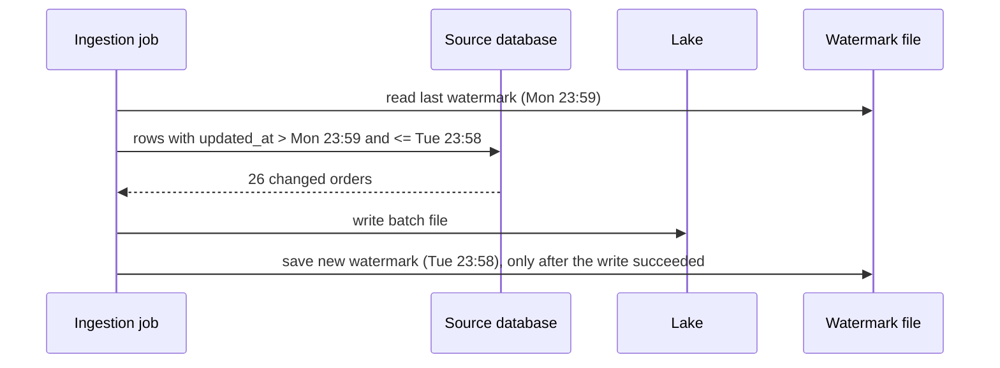

# Ingestion patterns that survive real life

## Full snapshot or incremental?

| | Full snapshot | Incremental (differential) |
|---|---|---|
| What you copy | The whole table, every run | Only rows that changed since last time |
| Needs | Nothing special | A reliable change marker (`updated_at`, a log position) and a stored bookmark |
| Catches deletes | Yes (a row is missing) | Only soft deletes, or deletes in a CDC log |
| Good for | Small tables (Inkwell's 10 books) | Big or fast-growing tables (orders, events) |

## The watermark: a bookmark for incremental loads

The order of the last two steps is the whole trick:

- **Write, then move the bookmark.** If the job crashes after writing but before saving, the next run re-reads the
  same rows. You get a duplicate copy, which transformation removes. You never **skip** data.
- **Name the batch after its window.** Re-running the same window overwrites the same file instead of adding one.
- **Save the bookmark atomically.** Write it to a temporary file, then rename it; a crash can't leave half a file.

## Batch CDC versus continuous CDC

| | Batch-oriented CDC | Continuous CDC |
|---|---|---|
| How | Query `updated_at > last watermark` | Read every insert, update and delete from the database log |
| Sees | The latest state of each changed row | **Every** change, in order |
| Misses | Changes in between runs (shipped then delivered = only "delivered"); hard deletes | Little |
| Setup | One SQL query | Log access and a CDC tool |

## Messy events: what to do with each problem

| Problem | At ingestion | Later, in transformation |
|---|---|---|
| Broken record (unreadable JSON) | Send it to a **dead-letter** file with the reason; keep going | Someone looks at the dead letters and fixes the source |
| Duplicate (same `event_id` twice) | Keep it: raw data stays as it arrived | Keep the first copy of each `event_id` |
| Late event (arrives a day later) | Keep it, with its event time and source file | Count it on its event day; decide how long to wait |
| Schema change (a new field) | Store it; don't crash | Add it to the model when it's needed |

## ETL or ELT?

**ETL** transforms data before loading it into the warehouse; **ELT** loads raw data first and transforms it inside
the warehouse or lake. Inkwell uses ELT: ingestion only copies and records, and all business logic lives in one
place, transformation. If the logic was wrong, you fix it and rebuild from the raw data.

## What to take away

- Move the watermark only after the data is safely written.
- Never lose a bad record: dead-letter it.
- Keep raw data as it arrived; remove duplicates and handle late data in transformation.
