# How to read a query plan, and three ways to scan less

## A query plan, read from the bottom up

```text
Hash Group By        groups:  city               <- 3. group what's left
  Projection         city, qty * unit_price      <- 2. compute only what's needed
    Read Parquet     columns: city, qty, unit_price
                     file filters: year = 2024, month = 3
                     scanning files: 1/60       <- 1. read as little as possible
```

The bottom step reads data; each step above works on its output. When a query is slow, the answer is usually at the
bottom: **how much is being read**. Look for:

- **which columns** are read (projection pushdown: only the ones the query uses?);
- **which files or partitions** are read (partition pruning: 1 of 60, or 60 of 60?);
- whether **filters** are applied while reading (predicate pushdown) or after;
- **join** steps whose output is much bigger than their inputs.

## Three ways to scan less

| Technique | How | Inkwell example |
|---|---|---|
| **Column pruning** | Name the columns you need; avoid `SELECT *` | Revenue by genre reads 3 columns of 10 |
| **Partition pruning** | Filter on the partition columns | `WHERE year = 2024 AND month = 3` opens one folder |
| **Pre-aggregation** | Store a small summary table that many queries share | A daily sales table instead of scanning every order line |

On pay-per-query warehouses this isn't only about speed: **you pay for bytes scanned**. `SELECT *` on a big table can
cost real money every time a dashboard refreshes.

## Row explosion: the silent wrong answer

```text
orders (1 row per order)         cities (2 rows for Cairo!)
order 7, Cairo, 100        JOIN  Cairo, North
                                 Cairo, Delta
=> 2 rows for order 7, and revenue 200 instead of 100
```

No error, no warning, just a bigger number. Habits that catch it:

- Before a join, check the key is **unique** on one side: `SELECT key, count(*) FROM t GROUP BY 1 HAVING count(*) > 1`.
- Compare **row counts** before and after the join.
- Compare a **total** (revenue) before and after the join.

## Windows over streams

```mermaid
gantt
    dateFormat HH:mm
    axisFormat %H:%M
    section Tumbling (fixed)
    00-06 :a1, 00:00, 6h
    06-12 :a2, 06:00, 6h
    12-18 :a3, 12:00, 6h
    section Sliding
    00-06 :b1, 00:00, 6h
    03-09 :b2, 03:00, 6h
    06-12 :b3, 06:00, 6h
```



- **Tumbling (fixed-time)** windows don't overlap: every event belongs to exactly one window.
- **Sliding** windows overlap: "the last 6 hours, updated every 3 hours".
- **Session** windows have no fixed length: a session ends after a gap of inactivity (say, 30 minutes).

A stream processor can't wait forever for late events. A **watermark** says "I believe all events up to time T have
arrived": when the watermark passes a window's end, the window closes. Events that come later still are either
dropped or handled separately.

## What to take away

- Read plans from the bottom; most slowness is reading too much.
- Prune columns and partitions; on cloud warehouses that's also money.
- Check keys, row counts and totals around every join.
