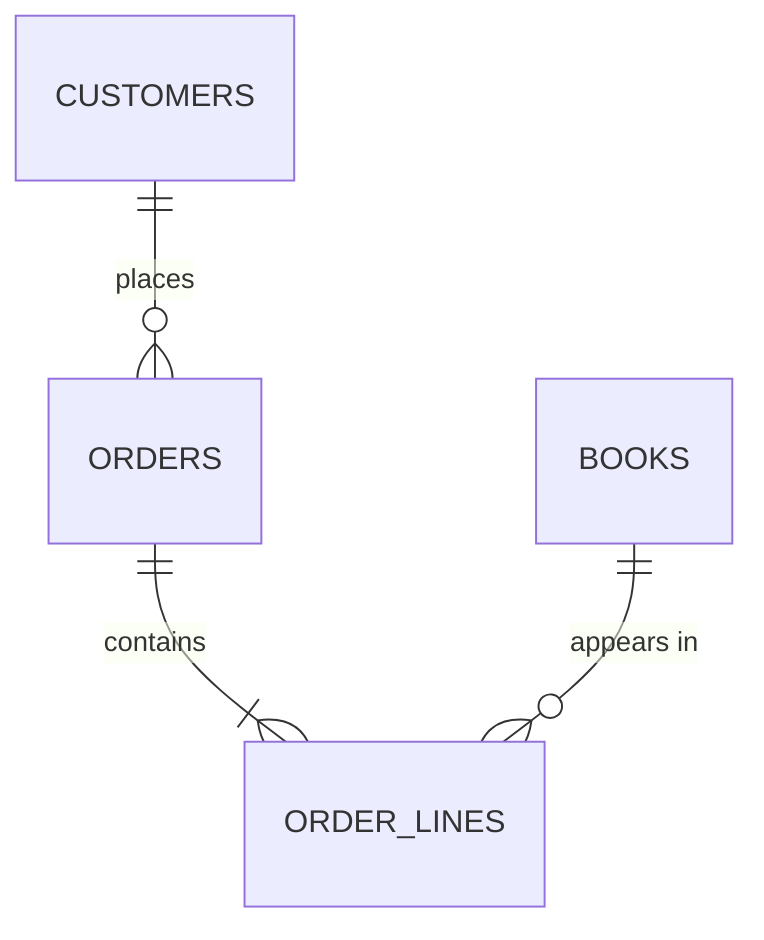
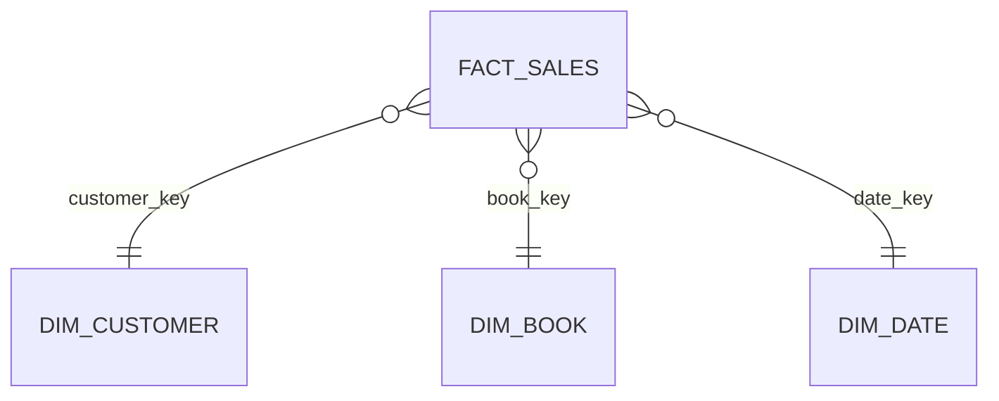

# Normalized, star schema, one big table

## The same data, three shapes

**Normalized (3NF)**, the app's shape: each fact stored once. Great for writing (change a customer's city in one
place), more joins for reading.

**Star schema (Kimball)**: one fact table in the middle, dimensions around it. Few joins, all of the same simple shape.
Analysts and BI tools understand it at once.

**One big table**: the star schema joined once into a wide table. No joins at all for readers; every change to a
dimension means rewriting many rows.

| | Normalized | Star schema | One big table |
|---|---|---|---|
| Built for | Applications writing data | Analysts asking questions | Speed and simplicity of reading |
| Joins per question | Many | One per dimension | None |
| Duplicated data | None | Some (in dimensions) | A lot |
| Changing a customer's city | One row | One new dimension row (type 2) | Many rows |

## The grain comes first

The **grain** is what one row of the fact table means. For Inkwell: *one row per book in an order* (an order line).
Decide it before anything else, and write it at the top of the table's documentation. Mixing grains (some rows are
order lines, some are whole orders) is the most common cause of double-counted revenue.

## Slowly changing dimensions

Laila lives in Giza, buys a book, moves to Cairo, buys another.

**Type 1, overwrite**: her row says Cairo. Both sales now show as Cairo; Giza's history is gone.

**Type 2, add a row** (what you build today):

| customer_key | customer_id | city | valid_from | valid_to | is_current |
|---|---|---|---|---|---|
| 11 | 7 | Giza | 2026-03-01 09:12 | 2026-03-04 18:30 | false |
| 12 | 7 | Cairo | 2026-03-04 18:30 | 9999-12-31 | true |

The first sale points at key 11 (Giza), the second at key 12 (Cairo). "Revenue by city" stays true to what happened.
Note the **surrogate key** (`customer_key`): one per *version*, while `customer_id` stays the business's key.

**Type 3, add a column**: `current_city` and `previous_city`. Only one step of history.

## Where the "city" answer differs

"Revenue by city" can mean two things: the city the customer lives in **today**, or where they lived **when they
bought**. Both are valid questions. A good model can answer both, and its documentation says which a report uses.

## What to take away

- Decide the grain before building the fact table.
- Star schemas make analytics simple; normalized models make writing safe; wide tables make reading fast.
- Type 2 dimensions with surrogate keys keep history honest.
