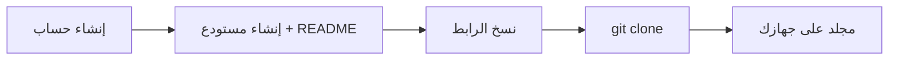

# تعلم Git + GitHub درس 03# - عمل Repository ونسخه إلى منطقة العمل

## ماذا تراقب في الفيديو
هذا أول درس عملي. راقب خطوات إنشاء الحساب والمستودع، وسبب وجود ملف README، وكيف تنسخ المستودع لجهازك.

## الأفكار الأساسية
**1) إنشاء حساب ومستودع:** تفتح حساباً على GitHub، ثم تضغط **New** لإنشاء مستودع جديد وتختار له اسماً.

**2) ملف README.md:** هو الملف الذي يعرّف بمشروعك لمن يزوره. تكتبه بلغة **Markdown**، وهي طريقة بسيطة لتنسيق النص. مثلاً علامة `#` قبل السطر تجعله عنواناً كبيراً، و`##` عنواناً أصغر.

**3) النسخ إلى جهازك (Clone):** تنسخ رابط المستودع (URL) ثم تنفذ في الطرفية:

```bash
git clone https://github.com/اسمك/اسم-المستودع.git
```

سينشأ مجلد جديد على جهازك فيه نسخة كاملة من المستودع، وهنا تبدأ العمل الفعلي.



ملاحظة: يعتمد الفيديو على Windows. إن كنت على Mac أو Linux فالأوامر نفسها تعمل في الـ Terminal.

## ملخص
تنشئ المستودع على GitHub مع README، ثم تنسخه لجهازك بـ `git clone` لتبدأ العمل عليه.
