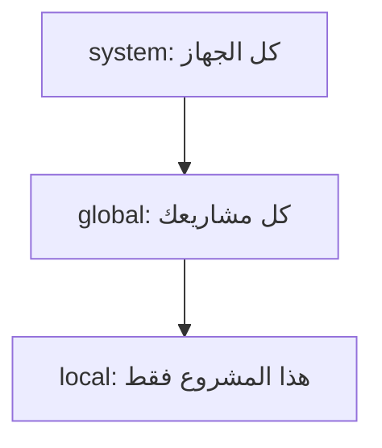

# تعلم Git + GitHub درس 07# - التعامل مع ال Git Configuration وتعديلها بكل الطرق

## ماذا تراقب في الفيديو
انتبه للمستويات الثلاثة للإعدادات، ولأيها الأكثر استخداماً.

## الأفكار الأساسية
لـ Git إعدادات تتحكم في سلوكه. أهمها هويتك، فاسمك وبريدك يظهران بجانب كل commit لتوثيق صاحب التعديل:

```bash
git config --global user.name "Ahmed Ali"
git config --global user.email "ahmed@example.com"
```

للإعدادات ثلاثة مستويات:

| المستوى | يسري على |
|---|---|
| `--system` | كل مستخدمي الجهاز |
| `--global` | كل مشاريع المستخدم الحالي على الجهاز (الأكثر استخداماً) |
| `--local` | مشروع محدد فقط |

ولعرض الإعدادات الحالية:

```bash
git config --list
```



## ملخص
اضبط `user.name` و`user.email` أول ما تثبّت Git. وللإعدادات ثلاثة مستويات: system وglobal وlocal.
