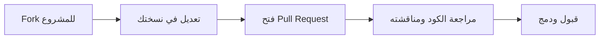

# تعلم Git + GitHub درس 10# - تعلم كل شيء عن Pull Request بأمثلة عملية من الواقع

## ماذا تراقب في الفيديو
راقب من يفعل ماذا: من يعدّل، ومن يراجع، ومن يقرر الدمج.

## الأفكار الأساسية
**الـ Pull Request (PR)** هو طلب ترسله لتقول: "عدّلت شيئاً، فهل تراجعه وتدمجه في المشروع؟". هو الطريقة المعتادة للتعاون في المشاريع المفتوحة وفرق العمل الكبيرة.

لتساهم في مشروع لا تملكه:

1. تعمل **Fork**: أي نسخة من مشروع الآخر في حسابك أنت.
2. تعدّل في نسختك.
3. تفتح **Pull Request** إلى صاحب المشروع الأصلي.
4. يراجع صاحب المشروع تعديلاتك ويناقشك فيها، وهذا هو **Code Review**، وفيه تُكتشف الأخطاء قبل القبول.
5. إذا وافق يدمج تعديلاتك رسمياً.

نصيحة: اكتب عنواناً ووصفاً واضحين للـ PR يشرحان ما غيّرته ولماذا، لتسهّل على المراجع.

## ملخص
تعمل Fork وتعدّل ثم تفتح PR، فيراجعه صاحب المشروع ويدمجه إن وافق. وبهذا لا تدخل التعديلات للمشروع إلا بعد مراجعتها.
