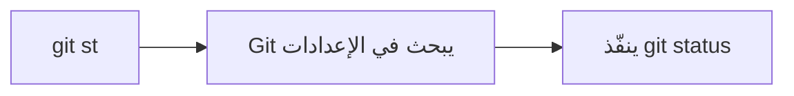

# تعلم Git + GitHub درس 11# - تعلم كل شيء عن الأسماء المستعارة Alias لتوفير الوقت

## ماذا تراقب في الفيديو
انتبه لطريقة تعريف الاختصار، وأين يُحفظ.

## الأفكار الأساسية
**الـ Alias** اسم مختصر تختاره بنفسك لأمر طويل تكرره كثيراً، لتوفر الوقت وتزيد إنتاجيتك. يُعرَّف بأمر `git config`:

```bash
git config --global alias.st status
git config --global alias.cm "commit -m"
```

وبعدها تكتب:

```bash
git st                  # بدل git status
git cm "Fix bug"        # بدل git commit -m "Fix bug"
```

تُحفظ الاختصارات في ملف إعدادات Git الذي تعلمت مستوياته في الدرس 07، فلا تضيع عند إغلاق الطرفية. والأمر الأصلي يبقى يعمل كما هو.



## ملخص
الـ Alias اختصار شخصي لأمر طويل، تعرّفه مرة واحدة في إعدادات Git ثم تستخدمه دائماً.
