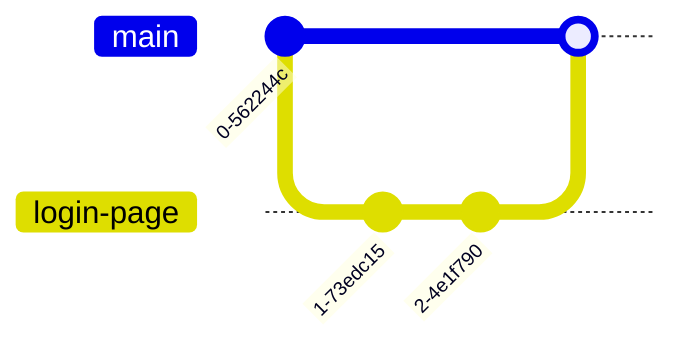

# تعلم Git + GitHub درس 12# - تعلم كل شيء عن ال Branching وكيفية الدمج

## ماذا تراقب في الفيديو
راقب كيف ينتقل Git بين الفروع، وماذا يحدث عند الدمج، وكيف يحل الدرس التعارض.

## الأفكار الأساسية
**الفروع (Branches)** تعزل الميزات الجديدة أو إصلاح الأخطاء عن الكود الرئيسي المستقر. تعمل في فرعك بحرية، ولا يتأثر `main` حتى تنتهي.

```bash
git branch login-page        # أنشئ فرعاً جديداً
git switch login-page        # انتقل إليه (أو git checkout)
# ... اعمل وسجّل commits ...
git switch main
git merge login-page         # ادمج الفرع في الفرع الحالي
```



**التعارض (Merge Conflict):** يحدث عندما يعدّل شخصان نفس السطر في نفس الملف، فلا يعرف Git أي النسختين يختار. فيضع علامات في الملف، وتحله أنت يدوياً: تفتح الملف، وتختار الصحيح أو تجمع النسختين، وتحذف العلامات، ثم تسجل commit لإنهاء الدمج.

## ملخص
الفرع مساحة آمنة للعمل، و`merge` يجمع عمله في الفرع الذي أنت عليه، والتعارض تحله بيدك عندما يعدل شخصان نفس السطر.
