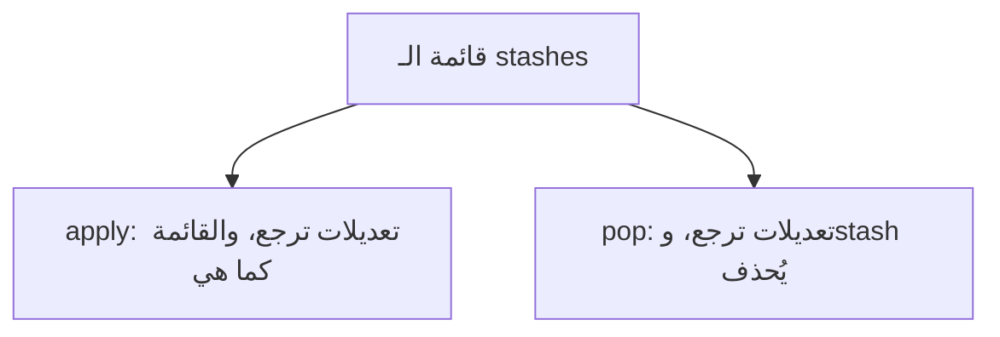

# تعلم Git + GitHub درس 14# - تعلم كل شيء عن ال Stash وتخزين الملفات الجزء الثاني

## ماذا تراقب في الفيديو
راقب الفرق بين `apply` و`pop`، وأوامر عرض الـ stashes وحذفها.

## الأفكار الأساسية
يمكنك أن تخزّن عدة مرات، فتتكون قائمة من الـ stashes. أوامر إدارتها:

```bash
git stash list         # اعرض كل الـ stashes المخزنة
git stash apply        # أعد آخر stash وأبقه في القائمة
git stash pop          # أعد آخر stash واحذفه من القائمة
git stash drop         # احذف stash واحداً
git stash clear        # احذف كل الـ stashes
```

وللتفريق بين الاسترجاعين:

| الأمر | الأثر |
|---|---|
| `git stash apply` | يرجع التعديلات ويترك الـ stash في القائمة |
| `git stash pop` | يرجع التعديلات ويحذف الـ stash |



## ملخص
`list` يعرض القائمة، و`apply` يسترجع ويُبقي، و`pop` يسترجع ويحذف، و`drop` يحذف واحداً، و`clear` يفرّغ القائمة.
