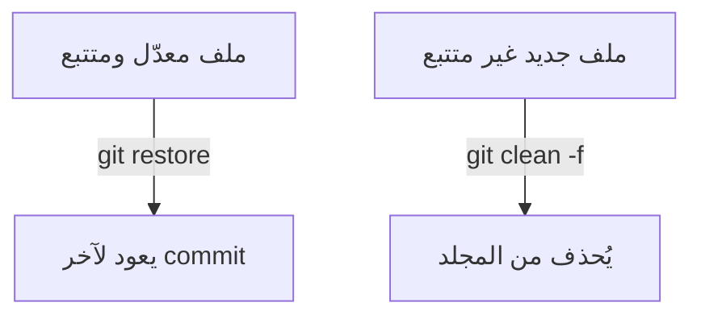

# تعلم Git + GitHub درس 15# - كل شيء عن ال Restore وال Clean

## ماذا تراقب في الفيديو
انتبه إلى نوع الملفات التي يعالجها كل أمر، وإلى تحذير الدرس من أمر `clean`.

## الأفكار الأساسية
**`git restore`** يتراجع عن التعديلات التي أجريتها على ملفات في منطقة العمل ولم تضفها بعد. يرجع الملف كما كان في آخر commit:

```bash
git restore index.html
```

**`git clean`** يحذف الملفات الزائدة غير المتتبعة (Untracked)، أي الملفات الجديدة التي لا يعرفها Git، من مجلد مشروعك:

```bash
git clean -n        # جرّب أولاً: اعرض ما سيُحذف دون حذف
git clean -f        # احذف فعلاً
```

**تحذير:** `clean` أمر خطير، لأن الملفات غير المتتبعة لم يسجلها Git، فإذا حُذفت لا تعود. ابدأ دائماً بـ `git clean -n`.



## ملخص
`restore` يتراجع عن تعديلات ملفات يعرفها Git، و`clean` يحذف ملفات لا يعرفها. جرّب `clean -n` قبل التنفيذ الفعلي.
