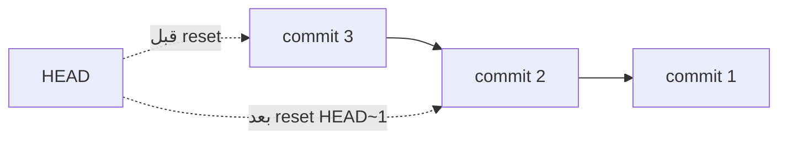

# تعلم Git + GitHub درس 16# - كيفية عمل Reset لل Head

## ماذا تراقب في الفيديو
راقب ماذا يحدث للـ commits ولتعديلاتك في كل نوع من أنواع `reset`. هذا أهم ما في الدرس.

## الأفكار الأساسية
**الـ HEAD** مؤشر يدل على النقطة التي تعمل عليها الآن في تاريخ مشروعك. أمر `git reset` يحرّكه إلى الوراء، وله ثلاثة أنواع:

| النوع | ما يحدث |
|---|---|
| `--soft` | يتراجع عن الـ commits ويُبقي التعديلات في Staging Area |
| `--mixed` (الافتراضي) | يتراجع ويُبقي التعديلات في Working Directory |
| `--hard` | تراجع كامل وخطير: يحذف التعديلات والـ commits ويعود لنقطة سابقة نظيفة |

```bash
git reset --soft HEAD~1    # تراجع عن آخر commit فقط
git reset HEAD~1           # mixed
git reset --hard HEAD~1    # احذر: يحذف تعديلاتك أيضاً
```

الرمز `HEAD~1` معناه الـ commit الذي قبل الأخير.



تنبيه: لا تستخدم `reset` على commits أرسلتها بـ push إن كان غيرك يعمل عليها، لأنك تغيّر التاريخ المشترك.

## ملخص
`reset` يرجع بالـ HEAD لنقطة أقدم. الأنواع الثلاثة تختلف فيما يبقى من تعديلاتك، و`--hard` يحذفها فاحذر منه.
