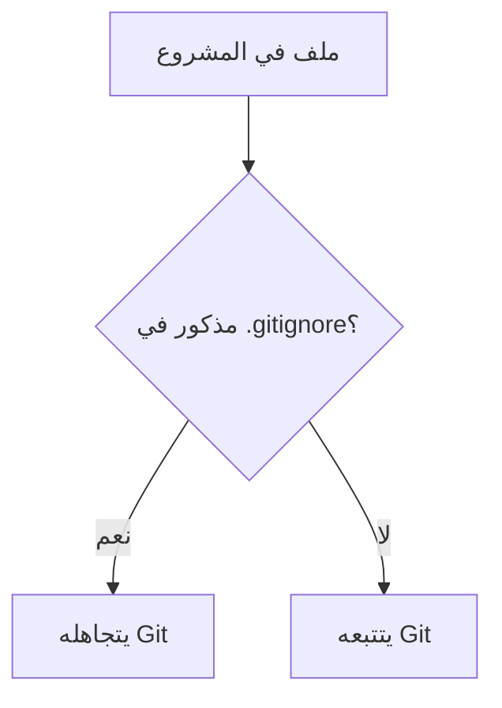

# تعلم Git + GitHub درس 17# - كيفية تجاهل الملفات بواسطة gitignore

## ماذا تراقب في الفيديو
راقب كيف تُكتب القواعد في الملف، وأي أنواع الملفات يُنصح بتجاهلها.

## الأفكار الأساسية
ليست كل الملفات تستحق أن تدخل المستودع. أمثلة على ما نستبعده:
- ملفات ضخمة.
- ملفات الإعدادات الشخصية.
- مجلدات مؤقتة مثل `node_modules`.
- ملفات البيئة `.env` التي قد تحوي كلمات مرور.

نكتب ما نريد تجاهله في ملف اسمه **`.gitignore`** داخل المشروع، فيتوقف Git عن تتبعه ورفعه إلى السحابة:

```
# هذا تعليق
.env
node_modules/
*.log
```

- `.env` يتجاهل ملفاً بهذا الاسم.
- `node_modules/` يتجاهل المجلد كله.
- `*.log` يتجاهل كل الملفات التي امتدادها `.log`.



تنبيه: إذا رُفع ملف سري إلى GitHub بالخطأ فحذفه لاحقاً لا يكفي، لأنه يبقى في تاريخ المشروع. غيّر كلمة المرور فوراً. والأفضل أن تكتب `.gitignore` قبل أول commit.

## ملخص
`.gitignore` يخبر Git بما لا يتتبعه ولا يرفعه، مثل `node_modules` وملفات `.env`، وتكتب فيه أسماء الملفات أو أنماطاً مثل `*.log`.
