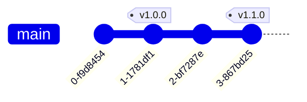

# تعلم Git + GitHub درس 18# - التعامل مع ال Tags ال Releases الجزء الأول

## ماذا تراقب في الفيديو
انتبه إلى نوعي الـ Tags، وكيف تنشئهما وتعرضهما وترسلهما للسحابة.

## الأفكار الأساسية
**الـ Tag** وسم باسم ثابت على نقطة محددة من تاريخ مشروعك، وغالباً يمثل إصداراً مستقراً مثل `v1.0.0`. على عكس الفرع، لا يتحرك الـ Tag مع الـ commits الجديدة.

نوعان:

| النوع | الوصف |
|---|---|
| **Lightweight** | اسم بسيط على commit، بلا معلومات إضافية |
| **Annotated** | يحمل رسالة واسم صاحبه وتاريخ إنشائه |

```bash
git tag v1.0.0                              # Lightweight
git tag -a v1.0.0 -m "First stable release" # Annotated
git tag                                     # اعرض الـ Tags
git show v1.0.0                             # تفاصيل Tag
git push origin v1.0.0                      # ارفعه للسحابة
```

ملاحظة: أمر `git push` العادي لا يرسل الـ Tags، فتحتاج أن ترسلها بنفسك.



## ملخص
الـ Tag وسم ثابت على إصدار مهم. الـ Lightweight اسم بسيط، والـ Annotated يحمل معلومات، وترسل الـ Tags للسحابة بـ push صريح.
