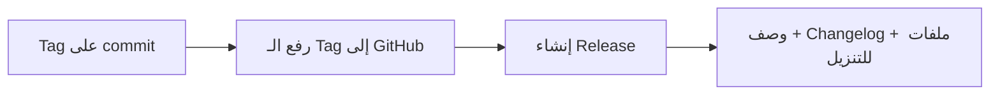

# تعلم Git + GitHub درس 19# - التعامل مع ال Tags ال Releases الجزء الثاني

## ماذا تراقب في الفيديو
راقب كيف يتحول الـ Tag إلى صفحة Release على GitHub، وما الذي تضيفه إليها.

## الأفكار الأساسية
بعد أن يصل الـ Tag إلى GitHub تستطيع تحويله إلى **Release**: إصدار رسمي ظاهر على صفحة المشروع. وفي الـ Release يمكنك:

- توثيق ميزات الإصدار.
- كتابة سجل التغييرات (**Changelog**) ليعرف المستخدمون ما الجديد.
- إرفاق ملفات الكود المضغوطة (Source Code بصيغة ZIP أو Tar.gz) للتنزيل.

فهكذا يعرف مستخدمو مشروعك أين يجدون آخر إصدار مستقر.

## ملخص
الـ Release هو الـ Tag بعد أن تقدمه للمستخدمين على GitHub مع وصفه وسجل تغييراته وملفات الكود للتنزيل.
