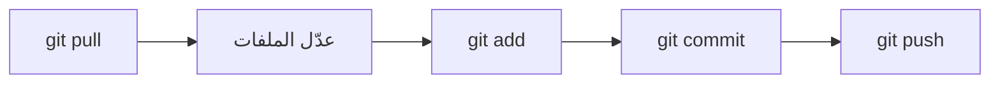

# تعلم Git + GitHub درس 20# - نهاية الدورة التعليمية وبعض النصائح

## ماذا تراقب في الفيديو
هذا درس الختام. انتبه للنصائح التي تساعدك على تثبيت ما تعلمته.

## الأفكار الأساسية
راجع حلقة عملك اليومية التي تعلمتها:

وما بنيته فوقها: الفروع للتجريب، والـ Pull Request للتعاون، والـ stash للأعمال غير الجاهزة، و`reset` و`restore` للتراجع، و`.gitignore` لتجاهل ما لا يلزم، والـ Tags والـ Releases للإصدارات.

نصائح الختام:
- استخدم Git وGitHub في كل مشاريعك القادمة مهما كانت صغيرة.
- داوم على الممارسة.
- شارك في مشاريع جماعية ومفتوحة المصدر لترسيخ مهاراتك.
- احذر من الأوامر التي تحذف العمل نهائياً مثل `reset --hard` و`clean -f`.

## ملخص
أصبحت تعرف دورة العمل الكاملة مع Git وGitHub. الممارسة المستمرة والمشاركة في المشاريع هما ما يرسخ المهارة.
