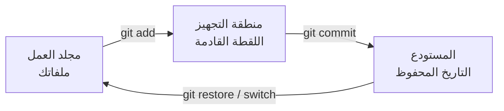

# ما هو Git، ولماذا يستخدمه الجميع

Git **نظام لإدارة الإصدارات**: يتذكّر كل نسخة من مشروعك، ومن غيّر ماذا، ومتى، ولماذا. يمكنك الرجوع إلى أي نسخة، والعمل على فكرتين في الوقت نفسه دون أن تكسر شيئًا، ودمج عملك مع عمل الآخرين. وتقريبًا كل فريق برمجة في العالم يستخدمه.

- **Git** هو البرنامج الذي على جهازك، ويعمل دون إنترنت.
- **GitHub** موقع يحفظ نسخة من مشروعك على الإنترنت، كي يراه الآخرون وينزّلوه ويرسلوا لك تعديلات. (و GitLab و Bitbucket مواقع مشابهة.)

تأخذك هذه الدورة من الصفر إلى مستوى المطوّر الخبير: الأوامر اليومية أولًا، ثم التراجع عن الأخطاء، والفروع، والعمل مع فريق، وإعادة كتابة التاريخ، وأدوات الخبراء، وكيف يعمل Git من الداخل.

> **فيديو اختياري في الأعلى.** جزء من كورس freeCodeCamp *Git and GitHub for Beginners, Crash Course*، من 1:10 إلى 5:20. كل ما تحتاجه موجود في النص أدناه، فشاهده فقط إن كان يفيدك: يحفظ inPace المكان الذي توقفت عنده.
>
> الفيديو بالإنجليزية: إن أردت مشاهدته فشغّل الترجمة (**CC**)، ثم **الإعدادات ← الترجمة ← ترجمة تلقائية ← العربية**.

## الأماكن الثلاثة التي يعيش فيها عملك

كل ملف في مشروع Git موجود في واحد من ثلاثة أماكن:

- **مجلد العمل:** الملفات التي تراها وتعدّلها.
- **منطقة التجهيز** (وتسمى أيضًا *index*): التغييرات التي اخترتها للحفظ القادم.
- **المستودع:** تاريخ اللقطات المحفوظة، وتسمى **commits**، ويُحفظ في مجلد مخفي اسمه `.git`.

الـ **commit** لقطة للمشروع كله في لحظة واحدة، مع رسالة تقول لماذا. والـ commits تكوّن سلسلة: كل واحد يشير إلى الذي قبله.

## الخطة

| الوحدة | ماذا تتعلم |
|---|---|
| 1 | التثبيت والإعداد وأول مستودع |
| 2 | التجهيز و diff والتاريخ و .gitignore والـ commits الجيدة |
| 3 | التراجع عن أي شيء: restore و reset و revert و reflog |
| 4 | الفروع والدمج والتعارضات |
| 5 | GitHub ومفاتيح SSH و push و pull و fetch |
| 6 | rebase و rebase التفاعلي |
| 7 | العمل مع فريق: استراتيجيات الفروع و forks وطلبات الدمج والوسوم |
| 8 | أدوات قوية: stash و cherry-pick و bisect و blame و worktrees |
| 9 | داخل Git: الكائنات والمراجع و HEAD |
| 10 | أدوات الإنقاذ، وإعداد المحترفين، و hooks، والتوقيع |

نحو 6 أسابيع بمعدل 3 إلى 4 ساعات أسبوعيًا. **الدروس المكتوبة هي الدورة.** وفوق بعضها جزء من فيديو على freeCodeCamp كإضافة اختيارية. وبعدها خذ *دورة GitHub: طلبات الدمج وسطر الأوامر و Actions*.
