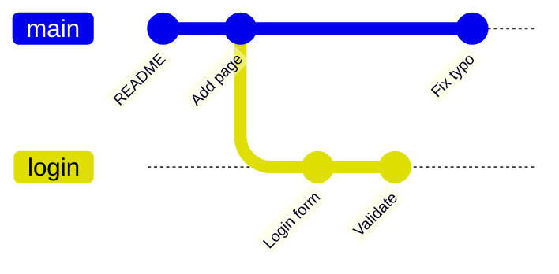

# الفروع مجرد مؤشرات

الـ **فرع** لافتة متحركة على commit. عندما تحفظ، تنتقل لافتة الفرع الذي أنت عليه إلى الـ commit الجديد. وصنع فرع لا يكلّف شيئًا، فاصنع فرعًا لكل ميزة أو إصلاح.

> **فيديو اختياري في الأعلى.** جزء من كورس freeCodeCamp *Git and GitHub for Beginners, Crash Course*، من 32:42 إلى 56:30. كل ما تحتاجه موجود في النص أدناه، فشاهده فقط إن كان يفيدك: يحفظ inPace المكان الذي توقفت عنده.
>
> الفيديو بالإنجليزية: إن أردت مشاهدته فشغّل الترجمة (**CC**)، ثم **الإعدادات ← الترجمة ← ترجمة تلقائية ← العربية**.



```bash
git branch                 # list branches, * marks the current one
git switch -c login        # make a branch and move to it
git switch main            # move back to main
git branch -v               # each branch with its newest commit
git branch -m old new      # rename
git branch -d login        # delete (only if it's merged)
git branch -D login        # delete even if not merged
```

**HEAD** هو مكانك: عادة يشير إلى فرع، والفرع يشير إلى commit. و `git switch` ينقل HEAD ويغيّر ملفاتك لتطابقه. وإن كانت لديك تغييرات غير محفوظة ستُكتب فوقها، يرفض Git: احفظها أو ضعها في الـ stash أولًا (الوحدة 8).
