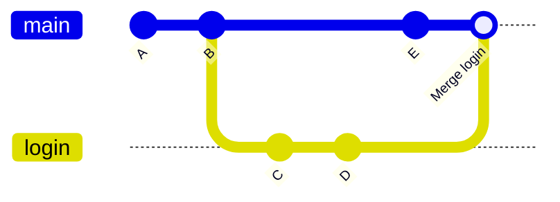

# الدمج

لتُدخل عمل فرع إلى main، اذهب إلى main وادمج:

```bash
git switch main
git merge login
```

يفعل Git واحدًا من أمرين:

- **Fast-forward:** لا توجد commits جديدة على main منذ بدأ الفرع، فيحرّك Git لافتة main للأمام فقط. دون commit جديد.
- **دمج ثلاثي (three-way):** في الطرفين commits جديدة. يقارنهما Git بالجد المشترك ويصنع **merge commit** له أبَوان.



و `git merge --no-ff login` يصنع merge commit دائمًا، حتى لو أمكن fast-forward، فيُظهر التاريخ الميزة كمجموعة واحدة. وبعد الدمج احذف الفرع: `git branch -d login`.
