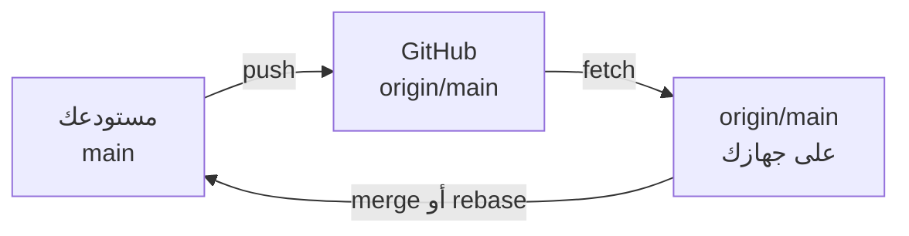

# clone و push و fetch و pull

الـ **remote** نسخة أخرى من المستودع، عادة على GitHub، واسمها الافتراضي **origin**.

```bash
git clone git@github.com:mona/notes.git      # download a repository with all its history

# or connect a repo you made with git init to a new empty GitHub repo:
git remote add origin git@github.com:mona/notes.git
git push -u origin main      # upload main; -u remembers origin/main for next time

git remote -v                # the remotes and their addresses
git push                     # upload new commits
git fetch                    # download what's new, but DON'T change your files
git pull                     # fetch + bring it into your branch
```



‏`origin/main` هو ذاكرة جهازك عن مكان main على GitHub، ويتحدث مع كل fetch. ويقول `git status` *Your branch is ahead of 'origin/main' by 2 commits* عندما تكون لديك commits لترفعها، و *behind* عندما توجد commits جديدة لتسحبها. و `git log --oneline main..origin/main` يسرد ما ستحصل عليه.
