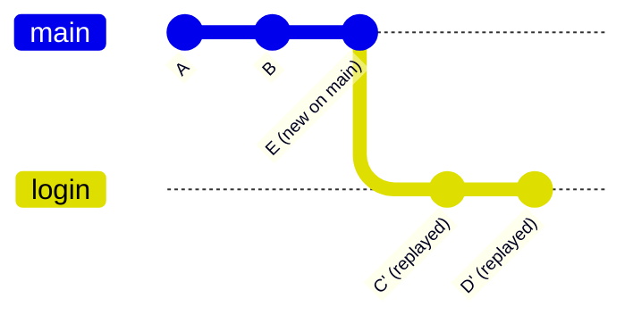

# merge أم rebase؟

كلاهما يجلب العمل من فرع إلى آخر، لكنهما يتركان تاريخًا مختلفًا.

**rebase** يأخذ commits فرعك ويعيد تطبيقها واحدًا تلو الآخر فوق فرع آخر، كأنك بدأت من هناك. فيصبح التاريخ خطًا مستقيمًا واحدًا.

> **فيديو اختياري في الأعلى.** جزء من كورس freeCodeCamp *Git for Professionals* (مع Tower)، من 33:48 إلى 40:05. كل ما تحتاجه موجود في النص أدناه، فشاهده فقط إن كان يفيدك: يحفظ inPace المكان الذي توقفت عنده.
>
> الفيديو بالإنجليزية: إن أردت مشاهدته فشغّل الترجمة (**CC**)، ثم **الإعدادات ← الترجمة ← ترجمة تلقائية ← العربية**.

```bash
git switch login
git rebase main          # replay login's commits on top of the newest main
git switch main
git merge login          # now a fast-forward: a straight line
```



الـ commits المعاد تطبيقها هي **commits جديدة** (C' و D') بـ hashes جديدة، ومن هنا القاعدة الذهبية.

## القاعدة الذهبية للـ rebase

**لا تعمل rebase إلا لـ commits لا يملكها غيرك.** إعادة ترتيب فرع ميزتك قبل أن تشاركه، أو السحب بـ `--rebase`، أمران آمنان. أما rebase لـ `main` أو لفرع يعمل عليه غيرك فيعيد كتابة commits صارت عندهم.

| | merge | rebase |
|---|---|---|
| التاريخ | حقيقي، مع merge commits | خط مستقيم نظيف |
| يعيد كتابة الـ commits | لا | نعم |
| آمن على الفروع المشتركة | نعم | لا |
| التعارضات | تُحل مرة واحدة | ربما مرة لكل commit |
