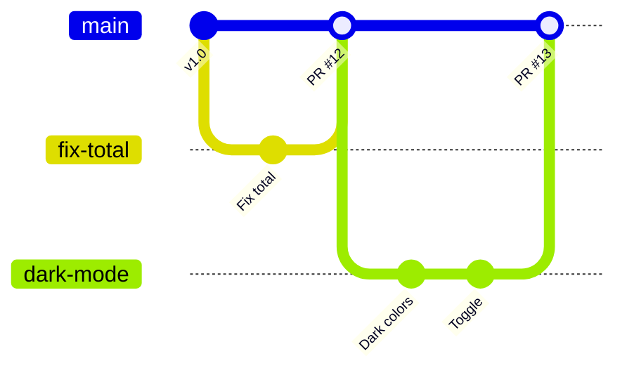

# استراتيجيات الفروع

يتفق الفريق على طريقة استخدام الفروع. وهذه الثلاث التي ستقابلها:

- **GitHub flow** (أغلب الفرق، وهذه الدورة): `main` قابل للإصدار دائمًا. كل تغيير له فرع قصير، وطلب دمج، ومراجعة، ثم يُدمج في main. بسيط وسريع.
- **التطوير على الجذع (trunk-based):** الجميع يدمج تغييرات صغيرة في main مرة يوميًا على الأقل، والميزات غير المكتملة تختبئ خلف *feature flags*. تعمل هكذا شركات كبيرة لديها اختبارات آلية قوية.
- **Git flow:** فرعان دائمان `main` و `develop`، مع فروع `feature/` و `release/` و `hotfix/`. أثقل، ويناسب البرامج ذات الإصدارات البطيئة المخطط لها (مثل تطبيقات الهاتف والبرامج المثبَّتة).

> **فيديو اختياري في الأعلى.** جزء من كورس freeCodeCamp *Git for Professionals* (مع Tower)، من 8:07 إلى 17:16. كل ما تحتاجه موجود في النص أدناه، فشاهده فقط إن كان يفيدك: يحفظ inPace المكان الذي توقفت عنده.
>
> الفيديو بالإنجليزية: إن أردت مشاهدته فشغّل الترجمة (**CC**)، ثم **الإعدادات ← الترجمة ← ترجمة تلقائية ← العربية**.

سمِّ الفروع بأسماء تقول ما تفعله: `fix/empty-total` و `feat/dark-mode` و `docs/install`. واحذفها بعد الدمج.
