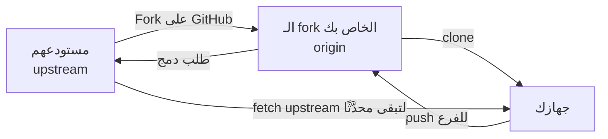

# الـ forks والمساهمة في مشاريع غيرك

لا يمكنك الرفع إلى مستودع شخص آخر. بدلًا من ذلك تعمل له **fork**: يصنع GitHub نسخة لك، فترفع إليها، ثم تطلب منهم سحب تغييرك.

> **فيديو اختياري في الأعلى.** جزء من كورس freeCodeCamp *Git and GitHub for Beginners, Crash Course*، من 1:01:50 إلى 1:07:55. كل ما تحتاجه موجود في النص أدناه، فشاهده فقط إن كان يفيدك: يحفظ inPace المكان الذي توقفت عنده.
>
> الفيديو بالإنجليزية: إن أردت مشاهدته فشغّل الترجمة (**CC**)، ثم **الإعدادات ← الترجمة ← ترجمة تلقائية ← العربية**.



```bash
git clone git@github.com:mona/their-project.git        # your fork
cd their-project
git remote add upstream git@github.com:owner/their-project.git
git switch -c fix/typo-in-readme
# ... change, commit ...
git push -u origin fix/typo-in-readme                 # then open the pull request on GitHub

# later, bring the original project's new work into yours:
git fetch upstream
git switch main
git merge upstream/main
git push
```

قبل أن تساهم، اقرأ ملف `CONTRIBUTING.md` في المشروع، وابحث عن issues عليها وسم **good first issue**، واجعل أول طلب دمج لك صغيرًا.
