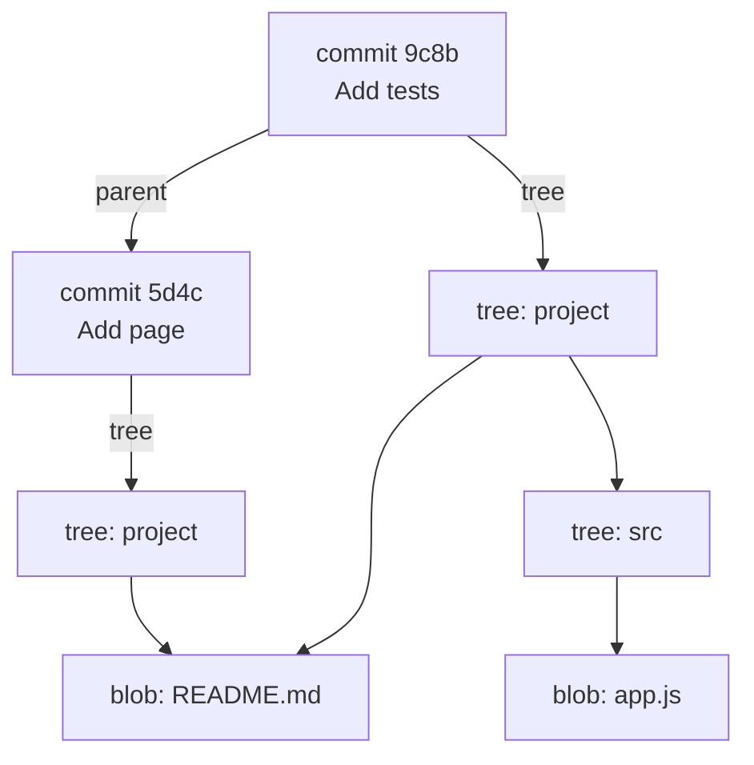

# الكائنات: blobs و trees و commits

تحت الأوامر، Git قاعدة بيانات بسيطة من **الكائنات**، وكل كائن اسمه hash من نوع SHA-1 لمحتواه (والمستودعات الأحدث يمكنها استخدام SHA-256). وهي أربعة أنواع:

- **blob:** محتوى ملف (بلا اسم، مجرد بايتات).
- **tree:** مجلد: أسماء تشير إلى blobs و trees أخرى.
- **commit:** tree (المشروع كله)، والـ commit الأب (أو الآباء)، والمؤلف، والتاريخ، والرسالة.
- **tag:** وسم annotated يشير إلى commit.



شاهدها بنفسك:

```bash
git cat-file -t HEAD                 # commit
git cat-file -p HEAD                 # tree ..., parent ..., author ..., message
git cat-file -p 'HEAD^{tree}'        # the folder: mode, type, hash, name
git cat-file -p HEAD:README.md       # a blob: the file's text
echo "hello" | git hash-object --stdin   # the hash Git would give this content
```

ويترتب على هذا ثلاثة أشياء:

- **نفس المحتوى، كائن واحد.** 100 ملف متطابق تُحفظ مرة واحدة، والملف الذي لم يتغير بين commit-ين لا يُحفظ مرة أخرى (لاحظ `blob: README.md` المشترك في الرسم).
- **لا شيء يتغير بصمت.** الـ hash يشمل الـ tree والأب، فتغيير أي شيء في الماضي يغيّر كل hash بعده. ولهذا تصنع إعادة كتابة التاريخ commits جديدة.
- **يحفظ Git لقطات، لا فروقًا.** يضغط الكائنات المتشابهة معًا لاحقًا (في *packfiles*)، لكن كل commit مشروع كامل.
