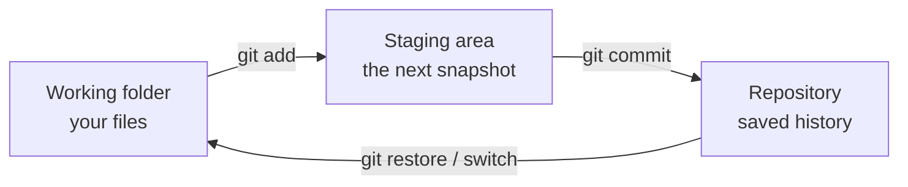

# What Git is, and why everyone uses it

Git is a **version control system**: it remembers every version of your project, who changed what, when and why. You can go back to any version, work on two ideas at once without breaking anything, and combine your work with other people's. Almost every software team in the world uses it.

- **Git** is the program on your computer. It works offline.
- **GitHub** is a website that keeps a copy of your Git project online, so others can see it, download it and send you changes. (GitLab and Bitbucket are similar sites.)

This course takes you from zero to the level of a senior developer: everyday commands first, then undoing mistakes, branches, teamwork, rewriting history, the tools experts use, and how Git works inside.

> **Optional video above.** Part of freeCodeCamp's *Git and GitHub for Beginners, Crash Course*, from 1:10 to 5:20. Everything you need is in the text below, so watch it only if it helps you: inPace remembers where you stopped.

## The three places your work lives

Every file in a Git project is in one of three places:

- **Working folder:** the files you see and edit.
- **Staging area** (also called the *index*): the changes you've chosen for the next save.
- **Repository:** the history of saved snapshots, called **commits**, kept in a hidden `.git` folder.

A **commit** is a snapshot of the whole project at one moment, with a message saying why. Commits form a chain: each one points to the one before it.

## The plan

| Module | What you learn |
|---|---|
| 1 | Install, set up, your first repository |
| 2 | Staging, diff, history, .gitignore, good commits |
| 3 | Undo anything: restore, reset, revert, reflog |
| 4 | Branches, merging, conflicts |
| 5 | GitHub, SSH keys, push, pull, fetch |
| 6 | Rebase and interactive rebase |
| 7 | Teamwork: branching strategies, forks, pull requests, tags |
| 8 | Power tools: stash, cherry-pick, bisect, blame, worktrees |
| 9 | Inside Git: objects, refs, HEAD |
| 10 | Rescue kit, pro setup, hooks, signing |

About 6 weeks at 3 to 4 hours a week. **The written lessons are the course.** Some have a part of a freeCodeCamp video on top, as an optional extra. Next, take *GitHub: pull requests, the CLI and Actions*.
