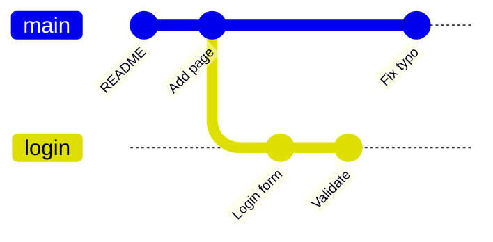

# Branches are just pointers

A **branch** is a movable label on a commit. When you commit, the label of the branch you're on moves to the new commit. Making a branch costs nothing, so make one for every feature or fix.

> **Optional video above.** Part of freeCodeCamp's *Git and GitHub for Beginners, Crash Course*, from 32:42 to 56:30. Everything you need is in the text below, so watch it only if it helps you: inPace remembers where you stopped.



```bash
git branch                 # list branches, * marks the current one
git switch -c login        # make a branch and move to it
git switch main            # move back to main
git branch -v               # each branch with its newest commit
git branch -m old new      # rename
git branch -d login        # delete (only if it's merged)
git branch -D login        # delete even if not merged
```

**HEAD** is where you are: normally it points to a branch, and the branch points to a commit. `git switch` moves HEAD and changes your files to match. If you have uncommitted changes that would be overwritten, Git refuses: commit or stash them first (module 8).
