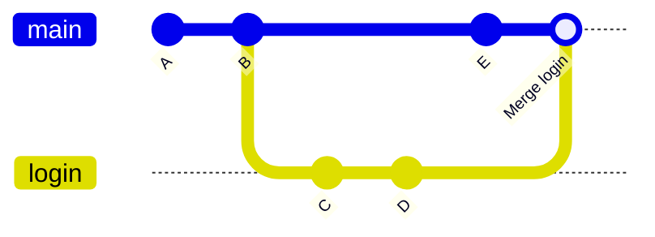

# Merging

To bring a branch's work into main, go to main and merge:

```bash
git switch main
git merge login
```

Git does one of two things:

- **Fast-forward:** main has no new commits since the branch started, so Git just moves the main label forward. No new commit.
- **Three-way merge:** both have new commits. Git compares them with their common ancestor and makes a **merge commit** with two parents.



`git merge --no-ff login` always makes a merge commit, even when a fast-forward was possible, so the history shows the feature as one group. After merging, delete the branch: `git branch -d login`.
