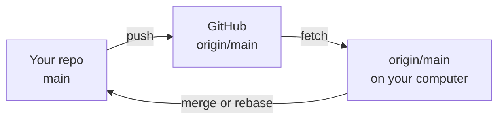

# clone, push, fetch and pull

A **remote** is another copy of the repository, usually on GitHub. Its default name is **origin**.

```bash
git clone git@github.com:mona/notes.git      # download a repository with all its history

# or connect a repo you made with git init to a new empty GitHub repo:
git remote add origin git@github.com:mona/notes.git
git push -u origin main      # upload main; -u remembers origin/main for next time

git remote -v                # the remotes and their addresses
git push                     # upload new commits
git fetch                    # download what's new, but DON'T change your files
git pull                     # fetch + bring it into your branch
```



`origin/main` is your computer's memory of where main is on GitHub, updated each time you fetch. `git status` says *Your branch is ahead of 'origin/main' by 2 commits* when you have commits to push, and *behind* when there are new ones to pull. `git log --oneline main..origin/main` lists what you'd get.
