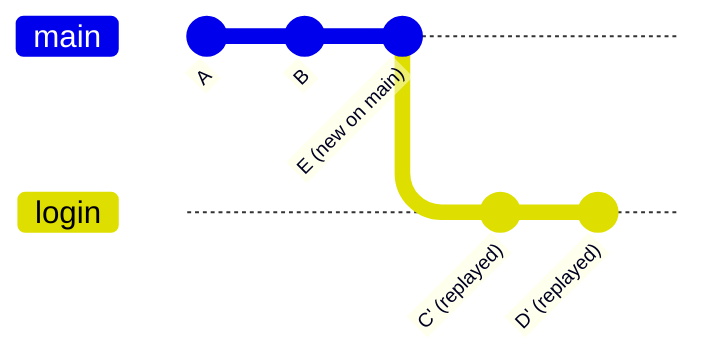

# Merge or rebase?

Both bring work from one branch into another. They leave different history.

**Rebase** takes your branch's commits and replays them, one by one, on top of another branch, as if you had started from there. The history becomes one straight line.

> **Optional video above.** Part of freeCodeCamp's *Git for Professionals* (with Tower), from 33:48 to 40:05. Everything you need is in the text below, so watch it only if it helps you: inPace remembers where you stopped.

```bash
git switch login
git rebase main          # replay login's commits on top of the newest main
git switch main
git merge login          # now a fast-forward: a straight line
```



The replayed commits are **new commits** (C' and D'), with new hashes. That leads to the golden rule.

## The golden rule of rebasing

**Only rebase commits that are only yours.** Rebasing your own feature branch before you share it, or pulling with `--rebase`, is fine. Rebasing `main` or a branch others work on rewrites commits they already have.

| | merge | rebase |
|---|---|---|
| History | true, with merge commits | clean straight line |
| Rewrites commits | no | yes |
| Safe on shared branches | yes | no |
| Conflicts | solved once | maybe once per commit |
