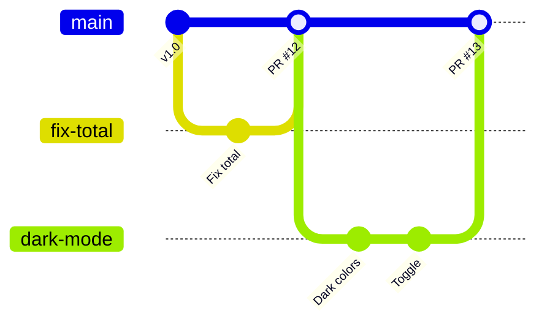

# Branching strategies

A team agrees on how branches are used. The three you'll meet:

- **GitHub flow** (most teams, and this course): `main` can always be released. Every change gets a short branch, a pull request, a review, and is merged into main. Simple and fast.
- **Trunk-based development:** everyone merges small changes into main at least once a day. Unfinished features hide behind *feature flags*. Big companies with strong automated tests work like this.
- **Git flow:** long-lived `main` and `develop` branches, plus `feature/`, `release/` and `hotfix/` branches. Heavier; fits software with slow, planned releases (like mobile apps or installed programs).

> **Optional video above.** Part of freeCodeCamp's *Git for Professionals* (with Tower), from 8:07 to 17:16. Everything you need is in the text below, so watch it only if it helps you: inPace remembers where you stopped.

Name branches so they say what they do: `fix/empty-total`, `feat/dark-mode`, `docs/install`. Delete them after merging.
