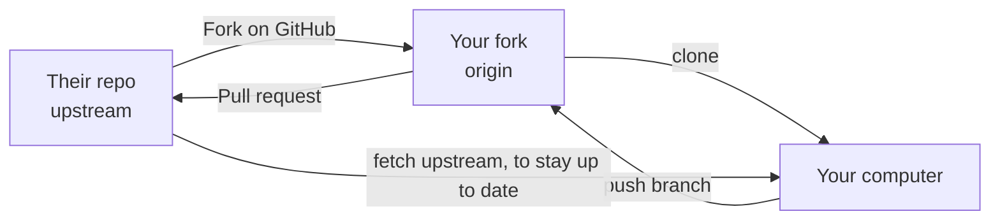

# Forks and contributing to other projects

You can't push to someone else's repository. Instead you **fork** it: GitHub makes your own copy, you push there, then ask them to pull your change.

> **Optional video above.** Part of freeCodeCamp's *Git and GitHub for Beginners, Crash Course*, from 1:01:50 to 1:07:55. Everything you need is in the text below, so watch it only if it helps you: inPace remembers where you stopped.



```bash
git clone git@github.com:mona/their-project.git        # your fork
cd their-project
git remote add upstream git@github.com:owner/their-project.git
git switch -c fix/typo-in-readme
# ... change, commit ...
git push -u origin fix/typo-in-readme                 # then open the pull request on GitHub

# later, bring the original project's new work into yours:
git fetch upstream
git switch main
git merge upstream/main
git push
```

Before you contribute, read the project's `CONTRIBUTING.md`, look for issues labelled **good first issue**, and keep your first pull request small.
