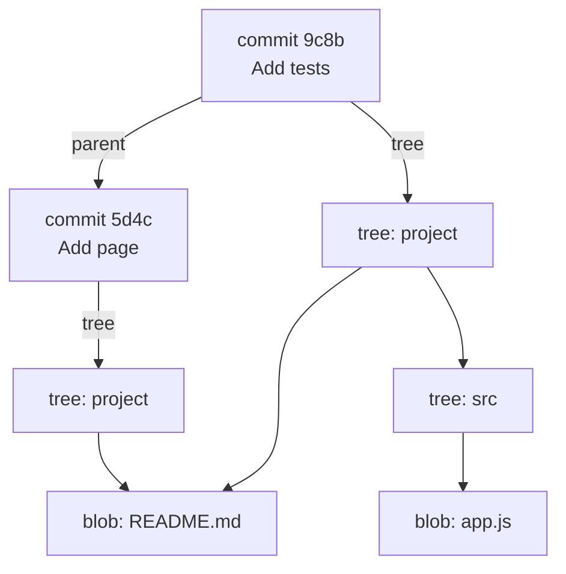

# Objects: blobs, trees and commits

Under the commands, Git is a simple database of **objects**, each named by the SHA-1 hash of its content (newer repositories can use SHA-256). There are four kinds:

- **blob:** the content of a file (no name, just bytes).
- **tree:** a folder: names pointing to blobs and other trees.
- **commit:** a tree (the whole project), its parent commit(s), the author, the date and the message.
- **tag:** an annotated tag pointing to a commit.



See them yourself:

```bash
git cat-file -t HEAD                 # commit
git cat-file -p HEAD                 # tree ..., parent ..., author ..., message
git cat-file -p 'HEAD^{tree}'        # the folder: mode, type, hash, name
git cat-file -p HEAD:README.md       # a blob: the file's text
echo "hello" | git hash-object --stdin   # the hash Git would give this content
```

Three things follow from this:

- **Same content, one object.** 100 identical files are stored once, and a file that didn't change between commits isn't stored again (see `blob: README.md` shared in the picture).
- **Nothing can change silently.** A commit's hash covers its tree and its parent, so changing anything in the past changes every hash after it. That's why rewriting history makes new commits.
- **Git stores snapshots, not differences.** It compresses similar objects together later (in *packfiles*), but every commit is a whole project.
