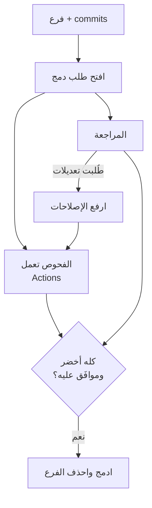

# طلب الدمج

الـ **pull request** (طلب الدمج، PR) يقول: "هذه commits فرعي، من فضلكم راجعوها وادمجوها في main." وهو المكان الذي تتحدث فيه الفرق عن الكود.

> **فيديو اختياري في الأعلى.** جزء من كورس freeCodeCamp *Git for Professionals* (مع Tower)، من 17:16 إلى 24:07. كل ما تحتاجه موجود في النص أدناه، فشاهده فقط إن كان يفيدك: يحفظ inPace المكان الذي توقفت عنده.
>
> الفيديو بالإنجليزية: إن أردت مشاهدته فشغّل الترجمة (**CC**)، ثم **الإعدادات ← الترجمة ← ترجمة تلقائية ← العربية**.



طلب الدمج الجيد:

- **صغير.** أقل من نحو 400 سطر متغير ينال مراجعة حقيقية، و3000 سطر ينال "يبدو جيدًا".
- **يشرح نفسه:** ماذا يتغير، ولماذا، وكيف اختبرته، وصور لأي شيء مرئي، و `Closes #12`.
- **مسودة (draft)** ما دمت تعمل عليه: يعرف المراجعون أن ينتظروا، والفحوص تعمل مع ذلك.

وقالب في `.github/pull_request_template.md` يملأ الوصف للجميع:

```markdown
# .github/pull_request_template.md
## What this changes

## Why

## How I tested it

- [ ] `npm test` passes
- [ ] I tried it in the browser

Closes #
```
