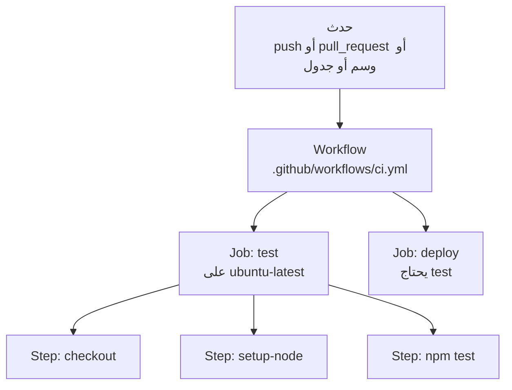

# ما هي Actions

**GitHub Actions** يشغّل أوامر بدلًا منك على أجهزة GitHub عندما يحدث شيء في مستودعك: يختبر كل push، وينشر الموقع عندما يتغير main، ويبني إصدارًا عندما ترفع وسمًا، ويضع وسومًا على الـ issues الجديدة. مجاني للمستودعات العامة، ومع دقائق مجانية كل شهر للخاصة.

> **فيديو اختياري في الأعلى.** جزء من فيديو TechWorld with Nana *GitHub Actions Tutorial*، من 1:03 إلى 9:50. كل ما تحتاجه موجود في النص أدناه، فشاهده فقط إن كان يفيدك: يحفظ inPace المكان الذي توقفت عنده.
>
> الفيديو بالإنجليزية: إن أردت مشاهدته فشغّل الترجمة (**CC**)، ثم **الإعدادات ← الترجمة ← ترجمة تلقائية ← العربية**.

- **Workflow:** ملف YAML في `.github/workflows/`، ويمكن للمستودع أن يحمل كثيرًا منها.
- **Event (الحدث):** ما يبدؤه (`push` و `pull_request` و `schedule` و `workflow_dispatch` لزر تشغيل و `release` و `issues`...).
- **Job:** مجموعة خطوات على جهاز جديد نظيف (**runner**: لينكس أو ويندوز أو ماك). وتعمل الـ jobs في الوقت نفسه إلا إن احتاج أحدها (`needs`) غيره.
- **Step (الخطوة):** إما أمر طرفية (`run:`) أو **action** جاهزة (`uses:`) مثل `actions/checkout`. وفي [Marketplace](https://github.com/marketplace?type=actions) الآلاف منها.
