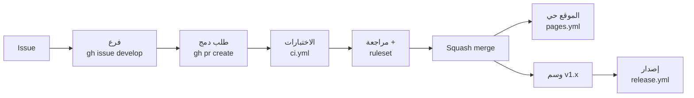

# المشروع: Study Tasks، من push إلى الإنتاج

اجمع كل شيء في مستودع حقيقي واحد. إن أخذت دورة *JavaScript: الدورة الكاملة* فاستخدم Study Tasks، وإلا فأي مشروع صغير فيه اختبارات يصلح.



## قائمة التحقق

1. **المستودع:** README فيه صورة وشارة الاختبارات، ورخصة، و `CONTRIBUTING.md`، ونموذج الـ issue، وقالب طلب الدمج، و `CODEOWNERS`.
2. **الـ workflows:** ‏`ci.yml` (اختبارات مع كل push وطلب دمج)، و `pages.yml` (الموقع)، و `release.yml` (الوسوم)، و `dependabot.yml`. وفي كل workflow إعداد `permissions:`.
3. **قواعد على main:** طلب دمج إلزامي، واختبارات إلزامية، ومنع الرفع بالقوة.
4. **الإعدادات:** squash فقط، وحذف الفروع بعد الدمج، وتفعيل تنبيهات Dependabot وفحص الأسرار.
5. **دورة كاملة بـ gh:** ‏issue، ثم `gh issue develop`، ثم commits، ثم `gh pr create --fill`، ثم `gh pr checks --watch`، ثم `gh pr merge --squash --delete-branch`، ثم `git tag -a v1.1.0` وارفعه. وشاهد الموقع يتحدث والإصدار يظهر.

ويجب أن يبدو المجلد هكذا:

```text
study-tasks/
├── .github/
│   ├── CODEOWNERS
│   ├── dependabot.yml
│   ├── pull_request_template.md
│   ├── ISSUE_TEMPLATE/
│   │   └── bug.yml
│   └── workflows/
│       ├── ci.yml
│       ├── pages.yml
│       └── release.yml
├── index.html  style.css  app.js
├── tasks.js  storage.js  tasks.test.js
├── package.json
├── CONTRIBUTING.md  LICENSE
└── README.md
```

هكذا تمامًا تعمل المشاريع مفتوحة المصدر الحقيقية (و inPace، التطبيق الذي تستخدمه، يعمل بهذه الطريقة). ضع رابط المستودع في سيرتك الذاتية: فهو يثبت أنك تُطلق منتجًا، لا أنك تكتب كودًا فقط.
