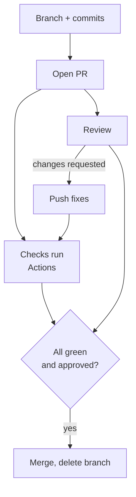

# The pull request

A **pull request** (PR) says: "here are the commits on my branch, please review them and merge them into main." It's where teams talk about code.

> **Optional video above.** Part of freeCodeCamp's *Git for Professionals* (with Tower), from 17:16 to 24:07. Everything you need is in the text below, so watch it only if it helps you: inPace remembers where you stopped.



A good pull request:

- **Is small.** Under about 400 changed lines gets a real review; 3000 lines gets "looks good".
- **Explains itself:** what changes, why, how you tested it, screenshots for anything visual, and `Closes #12`.
- **Is a draft** while you're still working: reviewers know to wait, and checks still run.

A template in `.github/pull_request_template.md` fills the description for everyone:

```markdown
# .github/pull_request_template.md
## What this changes

## Why

## How I tested it

- [ ] `npm test` passes
- [ ] I tried it in the browser

Closes #
```
