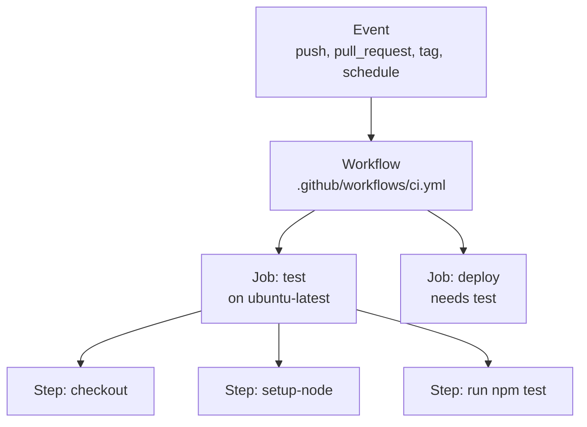

# What Actions are

**GitHub Actions** runs commands for you on GitHub's computers when something happens in your repository: test every push, publish the site when main changes, build a release when you push a tag, label new issues. Free for public repositories, and with free minutes every month for private ones.

> **Optional video above.** Part of TechWorld with Nana's *GitHub Actions Tutorial*, from 1:03 to 9:50. Everything you need is in the text below, so watch it only if it helps you: inPace remembers where you stopped.

- **Workflow:** a YAML file in `.github/workflows/`. A repository can have many.
- **Event:** what starts it (`push`, `pull_request`, `schedule`, `workflow_dispatch` for a button, `release`, `issues`...).
- **Job:** a group of steps on one fresh machine (a **runner**: Linux, Windows or Mac). Jobs run at the same time unless one `needs` another.
- **Step:** either a shell command (`run:`) or a ready-made **action** (`uses:`), like `actions/checkout`. Thousands are on the [Marketplace](https://github.com/marketplace?type=actions).
