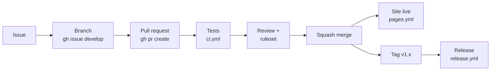

# Project: Study Tasks, from push to production

Put everything together on one real repository. If you took the *JavaScript: the full course*, use Study Tasks; otherwise any small project with tests works.



## The checklist

1. **Repository:** README with a screenshot and the tests badge, a license, `CONTRIBUTING.md`, the issue form, the pull request template, `CODEOWNERS`.
2. **Workflows:** `ci.yml` (tests on every push and pull request), `pages.yml` (site), `release.yml` (tags), `dependabot.yml`. Every workflow has `permissions:`.
3. **Rules on main:** pull request required, tests required, no force pushes.
4. **Settings:** squash merging only, delete branches after merge, Dependabot alerts and secret scanning on.
5. **One full loop with gh:** an issue, `gh issue develop`, commits, `gh pr create --fill`, `gh pr checks --watch`, `gh pr merge --squash --delete-branch`, then `git tag -a v1.1.0` and push it. Watch the site update and the release appear.

The folder should look like this:

```text
study-tasks/
├── .github/
│   ├── CODEOWNERS
│   ├── dependabot.yml
│   ├── pull_request_template.md
│   ├── ISSUE_TEMPLATE/
│   │   └── bug.yml
│   └── workflows/
│       ├── ci.yml
│       ├── pages.yml
│       └── release.yml
├── index.html  style.css  app.js
├── tasks.js  storage.js  tasks.test.js
├── package.json
├── CONTRIBUTING.md  LICENSE
└── README.md
```

This is exactly how real open-source projects run (inPace, the app you're using, works this way). Put the repository link on your CV: it shows you can ship, not only code.
