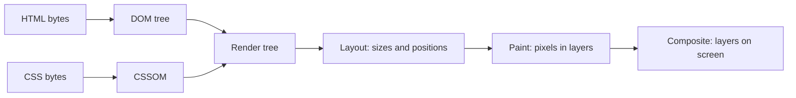

# From bytes to pixels

When the browser gets HTML, it runs the **critical rendering path**:

- **DOM**: the tree of elements built from HTML.
- **CSSOM**: the tree of style rules.
- **Render tree**: only what is visible (`display: none` is not in it).
- **Layout** (also called reflow): works out boxes. Expensive when big parts of the page change.
- **Paint and composite**: fills pixels; `transform` and `opacity` changes can often skip layout and paint, which is
  why smooth animations use them.

## What blocks rendering

- CSS in `<head>` is **render-blocking**: the browser waits for it, so the page doesn't flash unstyled.
- A plain `<script>` is **parser-blocking**: HTML parsing stops until it downloads and runs.
- `<script defer>` downloads in parallel and runs after parsing, in order. `async` runs as soon as it arrives, in any
  order.

inPace loads `style.css` in the head (with `?v=27` so a new version isn't served from cache) and puts `app.js` at the
**end of `<body>`**, which has the same effect as `defer`: the page is parsed before the script runs.

## Interview drill

> "What happens when you type a URL and press Enter?"

DNS lookup, TCP and TLS handshake, HTTP request, response, then the rendering path above. Mention caching
(`Cache-Control`), and that each extra CSS or JS file can delay the first paint.
