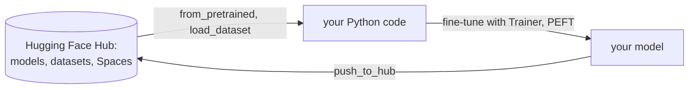

# The Hugging Face Hub and pipelines

**Hugging Face** is where most open models and datasets live. Its **Hub** hosts hundreds of thousands of models, datasets and demo apps; its Python libraries load them in a line or two:

| Library | For |
|---|---|
| `transformers` | pretrained models for text, vision, audio and multimodal tasks, mostly on PyTorch |
| `tokenizers` | fast tokenizers (written in Rust) |
| `datasets` | loading and processing datasets efficiently |
| `peft` | parameter-efficient fine-tuning (LoRA and friends) |
| `accelerate` | the same training code on CPU, one GPU, many GPUs or TPUs |
| `huggingface_hub` | downloading, uploading and searching the Hub |



## Install

```bash
pip install transformers datasets accelerate peft      # plus torch, from the PyTorch course
```

Models download on first use into a local cache (`~/.cache/huggingface`), so later runs work offline. Set the `HF_HOME` environment variable to cache somewhere else, and `HF_HUB_OFFLINE=1` to forbid downloads.

## Pipelines: a task in three lines

A **pipeline** bundles a tokenizer, a model and the post-processing for one task.

```python
from transformers import pipeline

classifier = pipeline("sentiment-analysis", model="distilbert/distilbert-base-uncased-finetuned-sst-2-english")
results = classifier(["I love this course", "The delivery was late and broken"])
for r in results:
    print(r["label"], round(r["score"], 3))
```

Always pass `model=` explicitly: the default model for a task can change between versions, which would silently change your results. Other tasks include `"text-generation"`, `"summarization"`, `"translation"`, `"question-answering"`, `"zero-shot-classification"`, `"ner"` (`"token-classification"`), `"fill-mask"`, `"image-classification"`, `"object-detection"` and `"automatic-speech-recognition"`.

## Choosing a model on the Hub

Read the **model card** before using any model:

- **Licence:** some are free for any use (Apache-2.0, MIT), some restrict commercial use or require accepting terms.
- **Training data and languages:** a model trained on English reviews won't understand Egyptian Arabic tweets.
- **Size:** parameters decide memory and speed (a 7B model needs about 14 GB in 16-bit).
- **Evaluation and limitations:** what it was tested on, and known biases.

Search by task, language and licence on huggingface.co/models, and prefer models with clear cards from known organisations. Arabic-capable models are available for most tasks; filter by language "ar".

## Optional videos

The lesson above is complete on its own. These go deeper, if you like learning by watching.

**Welcome to the Hugging Face course (Hugging Face)**

https://www.youtube.com/watch?v=00GKzGyWFEs

**Getting Started With Hugging Face in 15 Minutes (AssemblyAI)**

https://www.youtube.com/watch?v=QEaBAZQCtwE
