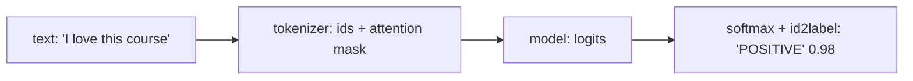

# Tokenizers and models, without the pipeline

Opening up the pipeline shows three steps you'll need for fine-tuning and custom use:



## The tokenizer

```python
import torch
from transformers import AutoTokenizer, AutoModelForSequenceClassification

name = "distilbert/distilbert-base-uncased-finetuned-sst-2-english"
tokenizer = AutoTokenizer.from_pretrained(name)
model = AutoModelForSequenceClassification.from_pretrained(name)

enc = tokenizer(["I love this course", "The delivery was late and broken"], padding=True, truncation=True,
                max_length=128, return_tensors="pt")
print(enc.keys())                                        # input_ids, attention_mask (some models add token_type_ids)
print(enc["input_ids"].shape, enc["attention_mask"][0].tolist())
print(tokenizer.convert_ids_to_tokens(enc["input_ids"][0]))
print(tokenizer.decode(enc["input_ids"][1], skip_special_tokens=True))
```

- `padding=True` pads to the longest text in the batch; the **attention mask** marks real tokens (1) and padding (0) so the model ignores padding.
- `truncation=True, max_length=...` cuts texts that are too long; every model has a maximum input length.
- Special tokens such as `[CLS]` and `[SEP]` (BERT-style) or end-of-text markers (GPT-style) are added automatically.
- The `Auto*` classes read the model's config and pick the right architecture, so the same code works for thousands of models.

## The model

```python
model.eval()
with torch.no_grad():
    out = model(**enc)
probs = out.logits.softmax(dim=-1)
for p in probs:
    label_id = int(p.argmax())
    print(model.config.id2label[label_id], round(float(p[label_id]), 3))
```

## Heads: the same body, different tasks

A pretrained transformer **body** turns tokens into contextual vectors; a small **head** maps them to the task's outputs. The `AutoModelFor...` class picks the head:

| Class | Head output |
|---|---|
| `AutoModel` | hidden states only (for embeddings or your own head) |
| `AutoModelForSequenceClassification` | one label per text |
| `AutoModelForTokenClassification` | one label per token (named entities) |
| `AutoModelForQuestionAnswering` | start and end positions of the answer |
| `AutoModelForCausalLM` | next-token logits (GPT-style generation) |
| `AutoModelForMaskedLM` | logits for masked tokens (BERT-style) |

```python
from transformers import AutoModel

body = AutoModel.from_pretrained("google-bert/bert-base-uncased")
bert_tok = AutoTokenizer.from_pretrained("google-bert/bert-base-uncased")
with torch.no_grad():
    hidden = body(**bert_tok(["refund please"], return_tensors="pt")).last_hidden_state
print(hidden.shape)                                      # (batch, tokens, hidden size): one vector per token
sentence_vec = hidden.mean(dim=1)                        # a simple sentence embedding: mean of token vectors
print(sentence_vec.shape)
```

For good sentence embeddings (search, clustering, RAG), use models trained for it, such as those in the `sentence-transformers` library.
