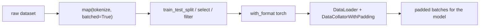

# Datasets: load, process, batch

The `datasets` library loads data from the Hub or local files into tables stored on disk in Apache Arrow format, so even datasets larger than memory are fast to slice and map.

```python
from datasets import load_dataset
from transformers import AutoTokenizer, DataCollatorWithPadding
from torch.utils.data import DataLoader

ds = load_dataset("stanfordnlp/imdb")                   # from the Hub; or load_dataset("csv", data_files={"train": "train.csv"})
print(ds)
print(ds["train"][0])
print(ds["train"].features)
```

A `DatasetDict` holds splits (`train`, `test`...); each split is a `Dataset` you can index like a list of dicts.

## Tokenise everything with map

```python
tokenizer = AutoTokenizer.from_pretrained("distilbert/distilbert-base-uncased")

def tokenize(batch):
    return tokenizer(batch["text"], truncation=True, max_length=256)   # no padding yet: pad per batch later

tokenized = ds.map(tokenize, batched=True, remove_columns=["text"])     # batched=True: many rows per call, much faster
print(tokenized["train"].column_names)

small = tokenized["train"].shuffle(seed=0).select(range(100))           # quick experiments on a subset
splits = tokenized["train"].train_test_split(test_size=0.2, seed=0)     # make a validation split
print(len(splits["train"]), len(splits["test"]))
short = ds["train"].filter(lambda ex: len(ex["text"]) < 60)
print("short reviews:", len(short))
```

Results of `map` are **cached** on disk: running the same function again is instant.

## Dynamic padding

Padding every text to the maximum length wastes compute. A **data collator** pads each batch to its own longest text:

```python
collator = DataCollatorWithPadding(tokenizer)
loader = DataLoader(splits["train"].with_format("torch"), batch_size=16, shuffle=True, collate_fn=collator)
batch = next(iter(loader))
print({k: tuple(v.shape) for k, v in batch.items()})                   # input_ids, attention_mask, labels
```



Note that the collator renamed `label` to `labels`, which is the name Hugging Face models expect for computing the loss.

## Large data

`load_dataset(..., streaming=True)` reads examples on the fly without downloading everything, useful for web-scale corpora such as FineWeb. Your own data can be shared on the Hub with `ds.push_to_hub("your-name/dataset-name")`, private if you like.
