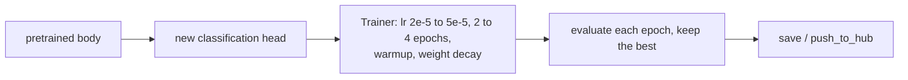

# Fine-tuning with the Trainer

The `Trainer` is a complete training loop for Hugging Face models: batching, mixed precision, gradient accumulation, evaluation, checkpoints, logging and multi-GPU, configured by `TrainingArguments`.

```python
import numpy as np
from datasets import load_dataset
from transformers import (AutoTokenizer, AutoModelForSequenceClassification, DataCollatorWithPadding,
                          Trainer, TrainingArguments)

name = "distilbert/distilbert-base-uncased"
tokenizer = AutoTokenizer.from_pretrained(name)
ds = load_dataset("stanfordnlp/imdb")
ds = ds.map(lambda b: tokenizer(b["text"], truncation=True, max_length=256), batched=True)
train = ds["train"].shuffle(seed=0).select(range(400))             # small subsets: a quick first run
test = ds["test"].shuffle(seed=0).select(range(200))

model = AutoModelForSequenceClassification.from_pretrained(
    name, num_labels=2, id2label={0: "NEGATIVE", 1: "POSITIVE"}, label2id={"NEGATIVE": 0, "POSITIVE": 1})

def compute_metrics(eval_pred):
    logits, labels = eval_pred
    return {"accuracy": float((np.argmax(logits, axis=-1) == labels).mean())}

args = TrainingArguments(
    output_dir="imdb-distilbert",
    learning_rate=5e-5,              # small: we're adjusting pretrained weights, not learning from scratch
    per_device_train_batch_size=16,
    num_train_epochs=3,
    weight_decay=0.01,
    warmup_steps=0.1,                # a float below 1 means "10% of all steps" (newer versions replaced warmup_ratio)
    eval_strategy="epoch",
    save_strategy="epoch",
    load_best_model_at_end=True,
    metric_for_best_model="accuracy",
    logging_steps=10,
    report_to="none",                # or "tensorboard", "wandb", "mlflow"
    seed=0,
)
trainer = Trainer(model=model, args=args, train_dataset=train, eval_dataset=test,
                  processing_class=tokenizer, data_collator=DataCollatorWithPadding(tokenizer),
                  compute_metrics=compute_metrics)
trainer.train()
print(trainer.evaluate())
```

Add `bf16=True` (or `fp16=True`) on a GPU for mixed precision, and `gradient_accumulation_steps` for bigger effective batches: everything from the PyTorch course, as settings.

## Save, reload, share

```python
trainer.save_model("imdb-distilbert/best")           # model + tokenizer + config
from transformers import pipeline
clf = pipeline("text-classification", model="imdb-distilbert/best")
print(clf("a wonderful, moving film"))
# trainer.push_to_hub("your-name/imdb-distilbert")   # after `hf auth login`: shareable, with a generated model card
```



## Fine-tuning tips

- Learning rates around 2e-5 to 5e-5 and a few epochs are typical for full fine-tuning of BERT-sized models; much higher rates destroy the pretrained knowledge.
- Start with a small subset to check the pipeline end to end, then scale up.
- Compare with a baseline (TF-IDF + logistic regression often scores surprisingly well on sentiment).
- For larger models, full fine-tuning gets expensive: that's what PEFT (module 3) is for.
