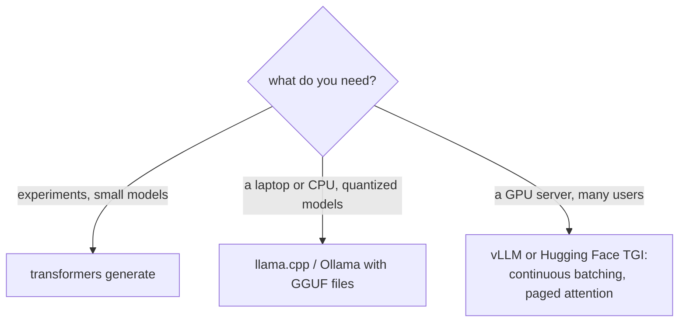

# Text generation and chat models

Generative models (`AutoModelForCausalLM`) produce text one token at a time, as in the LLM course. `generate()` runs the loop with the sampling settings you choose.

```python
import torch
from transformers import AutoTokenizer, AutoModelForCausalLM

name = "HuggingFaceTB/SmolLM2-135M-Instruct"          # a small open chat model that runs on a laptop CPU
tokenizer = AutoTokenizer.from_pretrained(name)
model = AutoModelForCausalLM.from_pretrained(name)     # on a GPU: dtype=torch.bfloat16, device_map="auto"

messages = [
    {"role": "system", "content": "You are a concise assistant."},
    {"role": "user", "content": "Give me two tips for learning PyTorch."},
]
inputs = tokenizer.apply_chat_template(messages, add_generation_prompt=True, return_tensors="pt", return_dict=True)
with torch.no_grad():
    out = model.generate(**inputs, max_new_tokens=60, do_sample=True, temperature=0.7, top_p=0.9,
                         pad_token_id=tokenizer.eos_token_id)
new_tokens = out[0, inputs["input_ids"].shape[1]:]     # drop the prompt, keep the answer
print(tokenizer.decode(new_tokens, skip_special_tokens=True))
```

## Chat templates

Each chat model was trained with its own format for roles (special tokens marking system, user and assistant turns). `apply_chat_template` builds exactly that format from a list of messages. Writing the format by hand, or using the wrong one, quietly makes a model much worse.

```python
print(tokenizer.apply_chat_template(messages, add_generation_prompt=True, tokenize=False)[:200])
```

## Generation settings

| Setting | Effect |
|---|---|
| `max_new_tokens` | length limit of the answer |
| `do_sample=False` | greedy: most likely token each step (repeatable) |
| `do_sample=True, temperature, top_p, top_k` | sampling, as in the LLM course |
| `repetition_penalty` | discourages repeating the same phrases |
| `num_beams` | beam search: keeps several candidates (translation, summarisation) |
| `stop_strings` (with `tokenizer=`) | stop at a given text |

## Streaming

```python
from transformers import TextStreamer

streamer = TextStreamer(tokenizer, skip_prompt=True, skip_special_tokens=True)
with torch.no_grad():
    model.generate(**inputs, max_new_tokens=20, do_sample=False, streamer=streamer, pad_token_id=tokenizer.eos_token_id)
```

`TextStreamer` prints tokens as they're produced; `TextIteratorStreamer` hands them to a web app.

## Running bigger models



`transformers` is the most flexible but not the fastest way to serve. For production traffic, dedicated servers such as **vLLM** use continuous batching and paged attention (from the LLM course) to serve many times more users per GPU, and expose an OpenAI-compatible API.

## Optional videos

The lesson above is complete on its own. These go deeper, if you like learning by watching.

**How I use LLMs (Andrej Karpathy)**

https://www.youtube.com/watch?v=EWvNQjAaOHw
