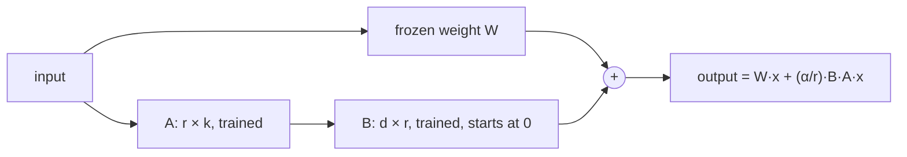

# Parameter-efficient fine-tuning with PEFT and LoRA

Full fine-tuning updates every weight: for a 7B model that needs well over 100 GB of GPU memory (weights, gradients and optimizer state). **LoRA** freezes the model and trains small low-rank matrices added to chosen layers, so you train well under 1% of the parameters, and the result is an adapter of a few megabytes.



```python
import torch
from transformers import AutoModelForSequenceClassification, AutoTokenizer
from peft import LoraConfig, get_peft_model, TaskType, PeftModel

name = "distilbert/distilbert-base-uncased"
model = AutoModelForSequenceClassification.from_pretrained(name, num_labels=2)
config = LoraConfig(
    task_type=TaskType.SEQ_CLS,      # keeps the new classification head trainable
    r=8,                             # rank of the update
    lora_alpha=16,                   # scaling; often 2 × r
    lora_dropout=0.1,
    target_modules=["q_lin", "v_lin"],   # which layers get adapters: DistilBERT's query and value projections
)
peft_model = get_peft_model(model, config)
peft_model.print_trainable_parameters()
```

Names differ by architecture: `q_lin`/`v_lin` in DistilBERT, `query`/`value` in BERT, `q_proj`/`v_proj` in Llama-style LLMs. Find them by printing the model (`print(model)`), or pass `target_modules="all-linear"`. Attention projections and, for LLMs, the MLP projections are the usual choices.

The PEFT model trains with the same `Trainer` as before (use a higher learning rate than full fine-tuning, around 1e-4 to 3e-4). Then:

```python
peft_model.save_pretrained("lora-adapter")              # only the adapter: a small file
import os
print(sorted(os.listdir("lora-adapter")))

base = AutoModelForSequenceClassification.from_pretrained(name, num_labels=2)
loaded = PeftModel.from_pretrained(base, "lora-adapter")
merged = loaded.merge_and_unload()                      # fold B·A into W: a normal model, no extra latency
print(type(merged).__name__)
```

## QLoRA: fine-tuning big models on one GPU

QLoRA loads the frozen base model in 4-bit (with the `bitsandbytes` library, on NVIDIA GPUs) and trains LoRA adapters on top in 16-bit. A 7B model then fits in roughly 10 to 16 GB of GPU memory for training. In code it's a `BitsAndBytesConfig(load_in_4bit=True, bnb_4bit_quant_type="nf4")` passed to `from_pretrained`, then the same `LoraConfig`.

## Fine-tuning LLMs on instructions

For chat models, the **TRL** library adds trainers for supervised fine-tuning on conversations (`SFTTrainer`, which applies the chat template for you) and preference tuning (`DPOTrainer`), both working with PEFT. The workflow from the AI engineer course still applies: an evaluation set and a prompted baseline first, clean examples, then compare quality, cost and latency.

| Method | Trains | Memory | Typical use |
|---|---|---|---|
| Full fine-tuning | all weights | highest | small models, maximum quality |
| LoRA | adapters (<1%) | much lower | most fine-tuning today |
| QLoRA | adapters on a 4-bit base | lowest | big models on one GPU |

## Optional videos

The lesson above is complete on its own. These go deeper, if you like learning by watching.

**LoRA explained visually, with PyTorch code (Umar Jamil)**

https://www.youtube.com/watch?v=PXWYUTMt-AU
