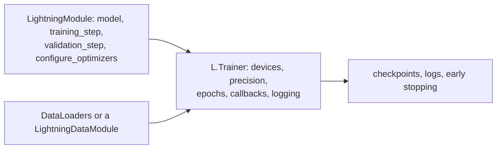

# PyTorch Lightning: organised training code

Every PyTorch project rewrites the same loop: device moves, `train()`/`eval()`, gradient steps, logging, checkpoints, early stopping, mixed precision, multi-GPU. **Lightning** keeps your model code in plain PyTorch and runs that engineering for you.



```python
import torch
from torch import nn
import torch.nn.functional as F
import lightning as L
from torch.utils.data import DataLoader, TensorDataset
from sklearn.datasets import load_digits

class DigitsModel(L.LightningModule):
    def __init__(self, lr=1e-3, hidden=128):
        super().__init__()
        self.save_hyperparameters()                   # stored in checkpoints and logs
        self.net = nn.Sequential(nn.Flatten(), nn.Linear(64, hidden), nn.ReLU(), nn.Dropout(0.2), nn.Linear(hidden, 10))

    def forward(self, x):
        return self.net(x)

    def training_step(self, batch, batch_idx):
        x, y = batch
        loss = F.cross_entropy(self(x), y)
        self.log("train_loss", loss, prog_bar=True)
        return loss                                   # Lightning calls backward() and step() for you

    def validation_step(self, batch, batch_idx):
        x, y = batch
        logits = self(x)
        self.log_dict({"val_loss": F.cross_entropy(logits, y), "val_acc": (logits.argmax(1) == y).float().mean()})

    def configure_optimizers(self):
        return torch.optim.AdamW(self.parameters(), lr=self.hparams.lr)

L.seed_everything(0)
d = load_digits()
X = torch.tensor(d.data, dtype=torch.float32) / 16.0
y = torch.tensor(d.target)
train_dl = DataLoader(TensorDataset(X[300:], y[300:]), batch_size=64, shuffle=True)
val_dl = DataLoader(TensorDataset(X[:300], y[:300]), batch_size=256)

trainer = L.Trainer(
    max_epochs=20, accelerator="auto", devices="auto",     # picks a GPU if there is one
    precision="32-true",                                  # "bf16-mixed" on a modern GPU
    callbacks=[L.pytorch.callbacks.EarlyStopping(monitor="val_loss", patience=4)],
    logger=False, enable_checkpointing=False, enable_progress_bar=False, enable_model_summary=False,
)
trainer.fit(DigitsModel(), train_dl, val_dl)
print({k: round(float(v), 3) for k, v in trainer.callback_metrics.items()})
```

## What you get for free

| Need | Lightning setting |
|---|---|
| GPU / multi-GPU / TPU | `accelerator`, `devices`, `strategy="ddp"` or `"fsdp"` |
| Mixed precision | `precision="bf16-mixed"` |
| Gradient clipping and accumulation | `gradient_clip_val=1.0`, `accumulate_grad_batches=4` |
| Checkpoints and resuming | `ModelCheckpoint` callback, `trainer.fit(..., ckpt_path="last")` |
| Logging | `logger=TensorBoardLogger(...)` or W&B, MLflow, CSV |
| A quick sanity run | `fast_dev_run=True`: one batch of train and validation |

Because your model is still an `nn.Module`, you can always drop back to plain PyTorch. **Lightning Fabric** is a lighter option: you keep your own loop and Fabric only handles devices, precision and distribution.
