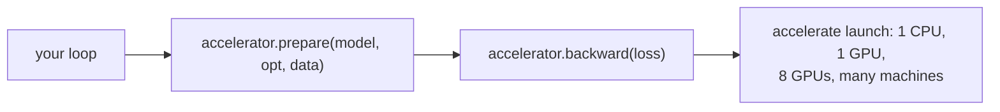

# Accelerate: one loop, any hardware

Hugging Face **Accelerate** takes the opposite approach to Lightning: keep your own training loop, add a few lines, and the same script runs on a CPU, one GPU, several GPUs, several machines or TPUs, with mixed precision and DeepSpeed or FSDP when configured.

```python
import torch
from torch import nn
from torch.utils.data import DataLoader, TensorDataset
from accelerate import Accelerator

accelerator = Accelerator(mixed_precision="no")           # "bf16" or "fp16" on GPUs; settings can also come from `accelerate config`
torch.manual_seed(0)
X = torch.randn(2048, 20); y = (X[:, :5].sum(1) > 0).long()
dl = DataLoader(TensorDataset(X, y), batch_size=64, shuffle=True)
model = nn.Sequential(nn.Linear(20, 64), nn.ReLU(), nn.Linear(64, 2))
opt = torch.optim.AdamW(model.parameters(), lr=1e-3)

model, opt, dl = accelerator.prepare(model, opt, dl)      # 1. wrap: moves to devices, shards data, wraps the model for DDP

for epoch in range(3):
    model.train()
    for xb, yb in dl:                                      # 2. no .to(device): batches arrive on the right device
        loss = nn.functional.cross_entropy(model(xb), yb)
        opt.zero_grad()
        accelerator.backward(loss)                         # 3. instead of loss.backward(): handles scaling and syncing
        opt.step()
    accelerator.print(f"epoch {epoch}: loss {loss.item():.3f}")   # prints once, on the main process

accelerator.wait_for_everyone()
unwrapped = accelerator.unwrap_model(model)
accelerator.save(unwrapped.state_dict(), "accelerate_model.pt")   # saves once
print("device:", accelerator.device, "| processes:", accelerator.num_processes)
```

Launch on several GPUs without changing the code:

```bash
accelerate config                       # answer a few questions once (GPUs, precision, DeepSpeed/FSDP)
accelerate launch train.py              # runs one process per GPU
```



## Which to choose?

| Tool | Choose it when |
|---|---|
| plain PyTorch | learning, small projects, full control |
| **Accelerate** | you want your own loop but easy multi-GPU and mixed precision; Hugging Face models |
| **Lightning** | you want structure, callbacks and logging decided for you |
| **Trainer** | standard fine-tuning of Hugging Face models (it uses Accelerate inside) |

All four produce ordinary PyTorch models, so switching later is cheap.
