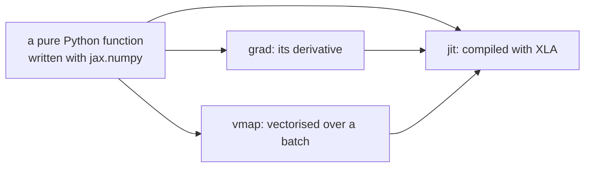

# JAX: NumPy that compiles and differentiates

**JAX** (from Google) is NumPy plus three function transformations. It's used for some of the largest model training (including at Google DeepMind) and much research, especially on TPUs. Keras 3 can run on it, and Flax provides neural network layers on top.



```python
import jax
import jax.numpy as jnp

def loss(w, x, y):
    pred = x @ w
    return jnp.mean((pred - y) ** 2)

key = jax.random.key(0)                         # explicit random keys: no hidden global state
k1, k2 = jax.random.split(key)
x = jax.random.normal(k1, (200, 3))
y = x @ jnp.array([2.0, -1.0, 0.5]) + 0.1 * jax.random.normal(k2, (200,))

grad_fn = jax.jit(jax.grad(loss))               # derivative with respect to the first argument, compiled
w = jnp.zeros(3)
for step in range(200):
    w = w - 0.1 * grad_fn(w, x, y)              # arrays are immutable: build new ones
print(w.round(2))

per_example = jax.vmap(jax.grad(loss), in_axes=(None, 0, 0))(w, x[:, None, :], y[:, None])
print(per_example.shape)                        # (200, 3): a gradient per example, no loop
```

## How JAX differs from PyTorch

| | PyTorch | JAX |
|---|---|---|
| Style | objects with state (`nn.Module`, optimizer) | **pure functions**; parameters passed in and returned |
| Gradients | `loss.backward()` fills `.grad` | `jax.grad(f)` returns a new function |
| Speed-ups | eager, plus `torch.compile` | `jax.jit` compiles to XLA from the start |
| Randomness | global seed | explicit keys you split and pass |
| Arrays | mutable | immutable (`x.at[0].set(1.0)` returns a new array) |

"Pure" means the function's output depends only on its inputs, with no side effects; that's what lets JAX compile, differentiate and parallelise it safely. Printing inside a jitted function, for instance, only happens during tracing (like `tf.function`).

```python
@jax.jit
def f(x):
    print("tracing with", x.shape)              # runs once per new shape
    return jnp.sin(x) * 2

f(jnp.ones(3)); f(jnp.ones(3)); f(jnp.ones(4))
z = jnp.zeros(3)
print(z.at[0].set(5.0), z)                      # a new array; z is unchanged
```

## The JAX ecosystem

- **Flax** (with its newer `nnx` API, closer to PyTorch's style) for layers and models; **Optax** for optimizers; **Orbax** for checkpoints.
- **Keras 3 with `KERAS_BACKEND=jax`** if you prefer Keras's `fit`.
- Scaling with `jax.sharding`: the same code runs across many TPU or GPU devices by annotating how arrays are split.

Learn JAX after you're fluent in PyTorch, if you aim for research labs or TPU-heavy teams.

## Optional videos

The lesson above is complete on its own. These go deeper, if you like learning by watching.

**JAX in 100 Seconds (Fireship)**

https://www.youtube.com/watch?v=_0D5lXDjNpw
