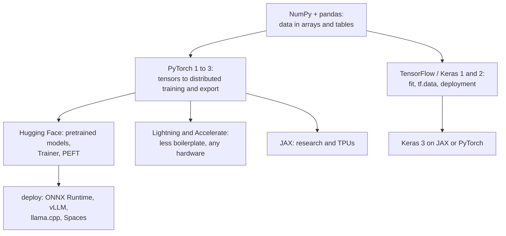

# Deploying Hugging Face models, and the ecosystem map

## Faster inference for small models: ONNX Runtime

For encoders like BERT on CPUs, exporting to ONNX and running with ONNX Runtime is often noticeably faster than eager PyTorch. Hugging Face's **Optimum** library automates it (`optimum-cli export onnx --model <name> out_dir/`); you can also export with plain PyTorch:

```python
import numpy as np
import torch
import onnxruntime as ort
from transformers import AutoTokenizer, AutoModelForSequenceClassification

name = "distilbert/distilbert-base-uncased-finetuned-sst-2-english"
tok = AutoTokenizer.from_pretrained(name)
model = AutoModelForSequenceClassification.from_pretrained(name).eval()
model.config.return_dict = False                       # plain tuple outputs export more simply

enc = tok(["an example sentence for export"], return_tensors="pt")
torch.onnx.export(model, (enc["input_ids"], enc["attention_mask"]), "classifier.onnx",
                  input_names=["input_ids", "attention_mask"], output_names=["logits"],
                  dynamic_axes={"input_ids": {0: "batch", 1: "seq"}, "attention_mask": {0: "batch", 1: "seq"}},
                  dynamo=False)

session = ort.InferenceSession("classifier.onnx", providers=["CPUExecutionProvider"])
batch = tok(["I love this course", "The delivery was late and broken"], padding=True, return_tensors="np")
onnx_logits = session.run(["logits"], {"input_ids": batch["input_ids"], "attention_mask": batch["attention_mask"]})[0]
with torch.no_grad():
    torch_logits = model(torch.tensor(batch["input_ids"]), torch.tensor(batch["attention_mask"]))[0].numpy()
print(np.abs(onnx_logits - torch_logits).max() < 1e-4, onnx_logits.argmax(-1))
```

As always after exporting: compare outputs on real inputs before shipping.

## Serving options

| Model type | Common choice |
|---|---|
| small classifiers and encoders | FastAPI + ONNX Runtime, or Hugging Face Inference Endpoints |
| embeddings at scale | Text Embeddings Inference (TEI) |
| LLMs on GPUs | **vLLM** or **SGLang**: continuous batching, OpenAI-compatible API |
| LLMs on laptops and CPUs | **llama.cpp** / **Ollama** with quantized GGUF files |
| a quick demo | a **Gradio** app on Hugging Face Spaces |

## The whole series on one map



## Where to go next

- The **Karpathy course** in this library: build GPT and its tokenizer from scratch, the best way to really understand what `transformers` hides.
- The **Hugging Face LLM Course** (free, huggingface.co/learn) for deeper NLP and LLM fine-tuning.
- Pick one project end to end: fine-tune a model on data you care about (Arabic customer messages, for example), compare it with a baseline and a prompted LLM, export it, and serve it with a small API. Put the results table in your README.
