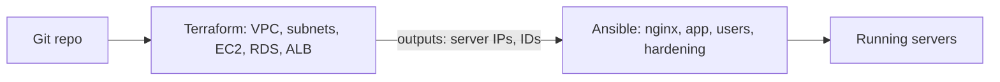

# Why infrastructure as code

In the AWS and Cloud Linux courses you clicked through the console and ran CLI commands. That teaches the pieces, but it doesn't scale: nobody remembers exactly what they clicked, staging drifts from production, and rebuilding after a disaster takes days.

**Infrastructure as code (IaC)** means your servers, networks and settings are described in text files, kept in Git, reviewed in pull requests and applied by tools.

## Two jobs, two tools

| Job | Question | Tool in this course |
|---|---|---|
| **Provisioning** | Which cloud resources exist? (VPC, EC2, RDS, DNS) | **Terraform** (or OpenTofu, its open-source fork) |
| **Configuration** | What's inside each server? (packages, files, services, users) | **Ansible** |

With golden AMIs or containers, much of Ansible's job moves into the image build (Packer can run Ansible). It's still the standard tool for configuring servers you keep.

## Declarative vs imperative

| Imperative (a script) | Declarative (IaC) |
|---|---|
| "Create a VPC, then create a subnet..." | "There is a VPC with these two subnets" |
| Running it twice creates duplicates | Running it twice changes nothing (**idempotent**) |
| You track what exists | The tool compares desired state with reality and plans the difference |

## Benefits you'll feel

- **Review**: infrastructure changes go through PRs like code.
- **Repeatable**: staging and production from the same code with different variables.
- **Disaster recovery**: rebuild a region from Git.
- **Documentation**: the code *is* the description of what exists.

## Optional videos

The lesson above is complete on its own. These go deeper, if you like learning by watching.

**Andrew Brown (freeCodeCamp): Terraform course, IaC concepts**

https://www.youtube.com/watch?v=V4waklkBC38&t=1021&end=2499
