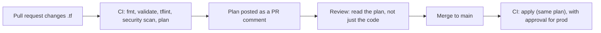

# Terraform in a team and in CI



```yaml
jobs:
  plan:
    runs-on: ubuntu-latest
    permissions: {id-token: write, contents: read, pull-requests: write}
    defaults: {run: {working-directory: infra/envs/prod}}
    steps:
      - uses: actions/checkout@v4
      - uses: hashicorp/setup-terraform@v3
      - uses: aws-actions/configure-aws-credentials@v4
        with: {role-to-assume: "arn:aws:iam::123456789012:role/tf-plan", aws-region: eu-central-1}
      - run: terraform init -input=false
      - run: terraform fmt -check -recursive
      - run: terraform validate
      - run: terraform plan -input=false -out=tfplan -no-color | tee plan.txt
```

## Practices

- **OIDC roles** (DevOps course): a read-only role for `plan` on PRs, a write role for `apply` only from `main` with an environment approval.
- **Lint and scan**: `tflint`, and Trivy or Checkov for misconfigurations (public buckets, open security groups).
- **Pin versions** of Terraform, providers (`.terraform.lock.hcl` committed to Git) and modules.
- **Protect important resources**:

```hcl
resource "aws_db_instance" "main" {
  # ...
  deletion_protection = true
  lifecycle { prevent_destroy = true }
}
```

Tools like Atlantis, Terraform Cloud/HCP Terraform, Spacelift or env0 run this PR workflow for you; plain GitHub Actions is fine to start.

## Optional videos

The lesson above is complete on its own. These go deeper, if you like learning by watching.

**Andrew Brown (freeCodeCamp): team workflows and backends**

https://www.youtube.com/watch?v=V4waklkBC38&t=26900&end=29131
